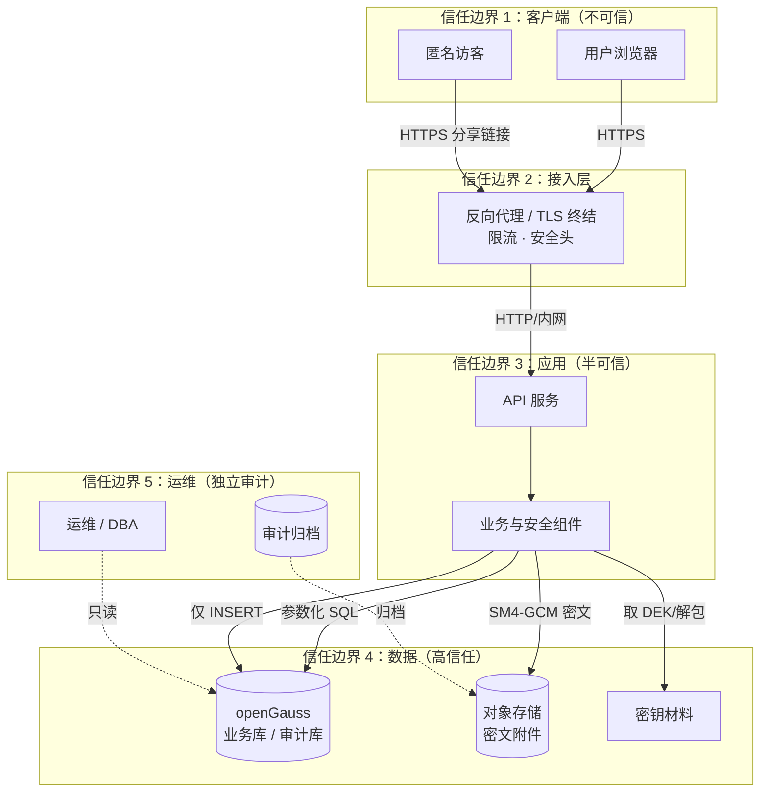
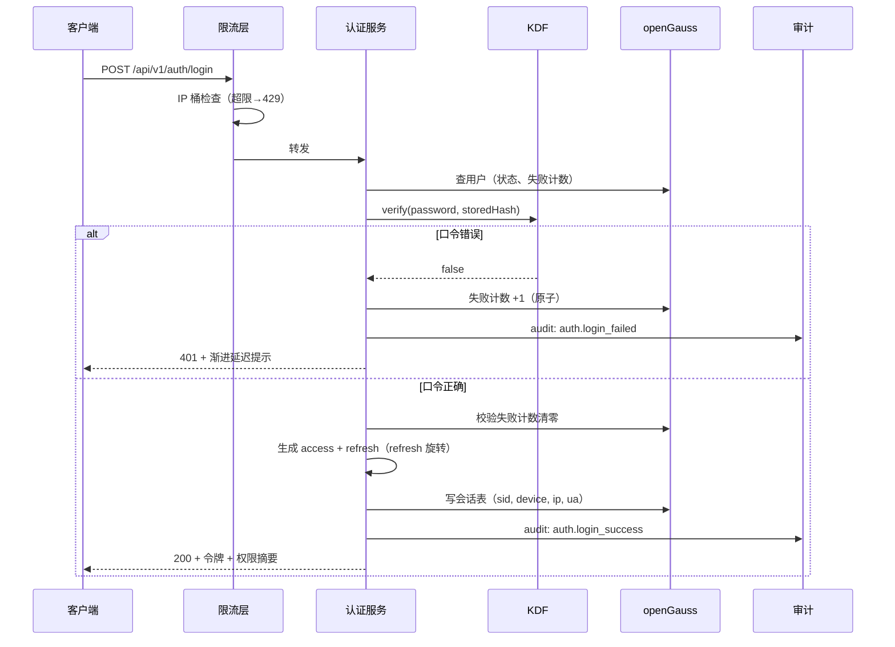

# 03 · 安全设计专章

**项目**：个人档案管理系统（AMS）
**版本**：v0.1（设计基线）
**日期**：2026-10-24
**关联**：`01-PRD-产品需求文档.md`、`02-架构设计说明.md`、`06-数据模型设计.md`

---

## 目录

1. [安全目标与合规基线](#1-安全目标与合规基线)
2. [资产与数据分级](#2-资产与数据分级)
3. [威胁模型（STRIDE）](#3-威胁模型stride)
4. [密码学与密钥管理](#4-密码学与密钥管理)
5. [认证与会话安全](#5-认证与会话安全)
6. [授权与访问控制](#6-授权与访问控制)
7. [审计与合规](#7-审计与合规)
8. [防护矩阵](#8-防护矩阵)
9. [安全运营](#9-安全运营)
10. [安全测试与验证](#10-安全测试与验证)
11. [安全设计取舍记录](#11-安全设计取舍记录)

---

## 1. 安全目标与合规基线

### 1.1 安全目标（按优先级）

| 优先级 | 目标 | 判定标准 |
| --- | --- | --- |
| S-1 | **机密性** | 证件号/手机/银行卡/健康/资产明文**永不**落库（含备份与日志） |
| S-2 | **完整性** | 档案条目与附件不可被未授权篡改；审计链可检测篡改 |
| S-3 | **可用性** | 限流与防护不得导致合法用户被 DoS；攻击流量下核心读路径保持可用 |
| S-4 | **不可否认性** | 敏感操作有可信留痕，可举证"谁在何时做了什么" |
| S-5 | **最小权限** | 默认拒绝；权限按角色授予 + 数据归属收敛 |
| S-6 | **可审计** | 审计覆盖 100% 敏感操作，链条可校验 |
| S-7 | **国密合规** | 口令、摘要、加密、签名链路使用 SM2/SM3/SM4 |

### 1.2 合规基线

| 基线 | 适用性 | 本章对应内容 |
| --- | --- | --- |
| **GB/T 22239-2019（等保 2.0）三级** | 私有化部署客户多为政企/金融背景 | §8 防护矩阵标注等保条款映射 |
| **GM/T 0054-2018（信息系统密码应用基本要求）** | 涉及国密算法使用 | §4 密码学方案、§7.4 密钥管理 |
| **GB/T 35273-2020（个人信息安全规范）** | 处理个人敏感信息 | §2 数据分级、§6.2 最小必要 |
| **《个人信息保护法》《数据安全法》** | 境内运营 | §2.1 处理原则、§6.3 授权与撤回 |
| **OWASP ASVS 4.0 L2/L3 / OWASP API Security Top 10** | 工程基线 | §8 防护矩阵 |
| **密码编码实践（RFC 8018 / NIST SP 800-132）** | 口令派生 | §4.1 |

> **说明**：本章不构成法律意见，也不替代专业的等保测评与商用密码应用安全性评估（密评）。若客户要求出具合规报告，需由具备资质的机构执行。本章提供**技术侧可自证的证据链**（日志、配置、测试报告），便于测评取证。

### 1.3 安全设计的三条铁律

1. **Fail-closed（失败关闭）**：安全组件异常时**拒绝**服务，绝不降级为不安全状态。
   - 例：密钥不可用 → 拒绝写入敏感字段，**不**降级为明文存储。
2. **默认拒绝（Default Deny）**：所有访问先判"是否禁止"，再判"是否允许"。
3. **最小必要（Least Privilege）**：只采集/只授权达成目的所必需的最小数据与最小范围。

---

## 2. 资产与数据分级

### 2.1 数据分类分级

| 级别 | 定义 | 示例 | 处理要求 |
| --- | --- | --- | --- |
| **L1 公开** | 可对外披露 | 分类字典、界面文案 | 无特殊要求 |
| **L2 内部** | 内部使用，泄露无实质损害 | 条目标题、备注、标签、创建时间 | 访问控制 + 审计 |
| **L3 敏感** | 泄露造成身份冒用风险 | 姓名、生日、住址、联系方式、学历、职业 | **字段级 SM4 加密** + 脱敏 + 审计 |
| **L4 高敏** | 泄露造成重大人身/财产损害 | 证件号、证件影像、银行卡、健康记录、资产估值、家庭成员证件 | **字段级 SM4 加密 + 强审计 + 显式授权 + 附件动态水印 + 导出管控** |

### 2.2 敏感字段清单（工程落地依据）

> ⚠️ **读表须知**：下表「加密落点」列的 `SM4-GCM` 是实现期的目标表述。SDK 实测 GCM 不可用，
> 实际落地为 **`SM4-CBC + HMAC-SM3`（Encrypt-then-MAC）**，见 [§4.0](#40--国密能力落地前提实测结论2026-10-24--已解决)
> 与 [08-SM4方案变更说明](./08-SM4方案变更说明.md)。级别划分、展示策略与审计要求不受影响。

| 字段 | 级别 | 加密落点 | 展示策略 | 审计要求 |
| --- | --- | --- | --- | --- |
| `id_card`（证件号） | L4 | SM4-GCM + 盲索引 | 列表 `1101**********34`（保留前4后2，对齐 FR-SRC-006） | 展开查看即审计 |
| `id_card_image`（证件影像附件） | L4 | 附件 SM4-GCM | 预览加水印 | 预览/下载均审计 |
| `bank_account`（银行卡号） | L4 | SM4-GCM + 盲索引 | `**** **** **** 1234` | 展开即审计 |
| `phone`（手机号） | L3 | SM4-GCM + 盲索引 | `138****8000` | 批量查看限速并告警 |
| `email` | L3 | SM4-GCM | 首尾掩码 | — |
| `address`（住址） | L3 | SM4-GCM | 区级掩码 | — |
| `health.*`（健康全部字段） | L4 | SM4-GCM（分类级加密） | 默认不可见 | 访问即审计 + 告警 |
| `asset.*`（资产估值、负债） | L4 | SM4-GCM（分类级加密） | 默认不可见 | 访问即审计 + 告警 |
| `family.id_card`（亲属证件号） | L4 | SM4-GCM | 全掩码 | 展开即审计 |
| `password_hash` | 凭据 | PBKDF2-HMAC-SM3 | 永不可见 | 仅认证使用 |
| `session_token` | 凭据 | SM3 摘要（服务端只存摘要） | 永不可见 | 异常使用告警 |

> **工程实现要点**：分级不是靠"每个字段手动标记"，而是**在字段元数据中声明 `sensitivity` 属性**，由框架在序列化层统一执行加密/脱敏/审计。新增字段时默认继承分类的敏感度（保守默认），只能显式下调，且下调需审计留痕。

### 2.3 密钥分级

| 级别 | 内容 | 存储位置 | 生命周期 |
| --- | --- | --- | --- |
| K0 | 根密钥（KEK） | 文件（600）或 KMS | ≥ 1 年，季度轮换 |
| K1 | 数据密钥（DEK，按用途分组） | 由 KEK 包裹后存 DB | 90 天轮换（可配） |
| K2 | 盲索引密钥 | 由 KEK 派生，存 DB | 跟随 K0 |
| K3 | 会话/令牌签名密钥 | 内存 + 启动加载 | 每次发布轮换 |
| K4 | 附件加密密钥 | 包裹存 DB（按附件或按租户） | 90 天 |

---

## 3. 威胁模型（STRIDE）

### 3.1 系统边界与数据流



**信任假设**：
- 客户端**完全不可信**（含已登录用户的浏览器）
- 应用进程环境可信，但**依赖库被攻破**是可能的（供应链风险）
- DBA **不完全可信**（运维与数据所有权分离原则）
- 对象存储**不可信**（视为可被读取的第三方介质）

### 3.2 STRIDE 威胁清单

| ID | STRIDE 类别 | 威胁描述 | 影响 | 攻击路径示例 | 缓解措施 | 验证方式 |
| --- | --- | --- | --- | --- | --- | --- |
| T-01 | **Spoofing 伪装** | 攻击者伪造他人身份登录 | 越权访问他人档案 | 撞库、重放登录请求、伪造 JWT | 强口令 + PBKDF2 迭代 + 失败锁定 + 令牌 SM3 签名 + 服务端会话校验 + 重放检测 | TC-SEC-01~05 |
| T-02 | **Spoofing 伪装** | 伪造他人分享链接访问 | 越权查看敏感材料 | 猜测/泄漏分享令牌 | 令牌 ≥ 128 bit 随机 + 口令保护 + 有效期 + 撤销位 + 访问计数 + 失败锁定 | TC-SEC-10 |
| T-03 | **Spoofing 伪装** | 伪造客户端 IP 逃避限流/封禁 | 绕过风控 | 伪造 `X-Forwarded-For` | **只信任明确配置的反向代理 IP 列表**，其余一律取 socket 对端地址 | TC-SEC-12 |
| T-04 | **Tampering 篡改** | SQL 注入导致数据被读取/篡改 | 全库泄露 | 拼接 SQL | 参数化查询强制 + DAO 层强制 `subject_id` + 动态排序白名单 + 注入用例库 | TC-SEC-20~24 |
| T-05 | **Tampering 篡改** | 存储型 XSS 篡改他人看到的页面 | 凭证窃取、以管理员身份操作 | 备注/标题注入脚本 | 输出上下文转义 + CSP（无 `unsafe-inline`）+ 禁止 `dangerouslySetInnerHTML` 等价写法 + 输入净化 | TC-SEC-25~28 |
| T-06 | **Tampering 篡改** | CSRF 诱导受害者执行敏感操作 | 越权授权、删除数据 | 跨站表单/图片 | `SameSite=Strict` Cookie + 双提交 Token + 写操作强制校验 + Origin/Referer 校验 | TC-SEC-29~31 |
| T-07 | **Tampering 篡改** | 附件被替换（上传后被篡改内容） | 证据失效 | 替换对象存储中的文件 | 附件 SM4-GCM（AEAD 认证）+ SM3 指纹入库校验 + 下载时校验指纹 + 版本只追加 | TC-SEC-32 |
| T-08 | **Tampering 篡改** | 审计记录被删除或修改 | 追溯失效、无法举证 | DBA 或应用账号改审计表 | 审计表应用账号仅 INSERT/SELECT + 哈希链 + 定期外部锚定（chain head 存独立位置）+ 告警 | TC-SEC-33~35 |
| T-09 | **Repudiation 否认** | 用户否认执行过某操作 | 无法追责 | — | 全量敏感操作审计（含操作者、时间、IP、UA、目标、结果）+ 哈希链 + 不可删除 | TC-SEC-36 |
| T-10 | **Information Disclosure 信息泄露** | 越权读取他人档案 | 隐私泄露 | 改 ID 参数（IDOR） | 归属校验 + 统一鉴权中间件 + 不返回资源存在性（403 而非 404 泄漏） | TC-SEC-40~42 |
| T-11 | **Information Disclosure 信息泄露** | SQL 注入或错误信息泄露数据 | 敏感信息外泄 | 报错回显 SQL | 统一错误码 + 生产环境不返回堆栈 + SQL 错误脱敏 + 全局异常处理器 | TC-SEC-22 |
| T-12 | **Information Disclosure 信息泄露** | 日志/监控/备份泄露敏感数据 | 长期潜伏泄露 | 明文落日志、备份未加密 | 日志字段脱敏器 + 备份加密 + 密钥不入日志 + CI 静态检查禁止打印敏感字段 | TC-SEC-43~45 |
| T-13 | **Information Disclosure 信息泄露** | 密文被关联分析（频次/长度泄漏） | 推断明文 | 统计密文分布 | 盲索引 per-subject 派生密钥 + 最小化暴露 + 密文等长化（padding）+ 分类级统一加密 | 密评复核 |
| T-14 | **Denial of Service 拒绝服务** | 暴力破解 / 撞库耗尽资源 | 账户锁定、算力耗尽 | 大量登录尝试 | 三级限流 + 指数退避 + 验证码 + IP 黑名单 + 异步化 + 熔断 | TC-SEC-50~53 |
| T-15 | **Denial of Service 拒绝服务** | 大文件/大导出拖垮服务 | 可用性下降 | 上传超大文件、导出全库 | 上传大小/类型/数量限制 + 流式处理 + 导出异步化 + 配额 + 连接数上限 | TC-SEC-54 |
| T-16 | **Denial of Service 拒绝服务** | 慢查询拖垮数据库 | 全站变慢 | 构造复杂筛选 | 筛选字段白名单 + 查询超时 + keyset 分页 + 慢查询监控 + 连接池隔离 | TC-PERF-07 |
| T-17 | **Elevation of Privilege 权限提升** | 普通用户提权为管理员 | 全面沦陷 | 修改角色关联、注入绕过鉴权 | 默认拒绝 + 中间件强制鉴权 + 权限点不可由前端传入 + 关键操作二次校验 + 管理员操作全审计 | TC-SEC-60~64 |
| T-18 | **Elevation of Privilege** | 横向越权（访问他人数据） | 隐私泄露 | 改 `subject_id` | 归属由服务端从会话推导 + DAO 强制注入 + 测试覆盖 | TC-SEC-40 |
| T-19 | **Elevation of Privilege** | 代管人访问未被授权的敏感分类 | 隐私泄露 | 构造高敏分类查询 | 分类级敏感度 + 显式授权 + 查询层二次过滤 + 审计告警 | TC-SEC-65 |
| T-20 | **Elevation of Privilege** | 密钥泄露导致全量数据解密 | 灾难级 | 备份泄露 + 弱 KEK | KEK 文件 600 + 不入库 + 轮换 + 备份加密 + 分离的密钥保管流程 | 密评复核 |
| T-21 | **Supply Chain 供应链** | 依赖库被植入后门 | 隐蔽后门 | 恶意版本 | 依赖锁定版本 + vendor 化 + SBOM 归档 + 漏洞扫描 + 定期升级评估 + 二进制签名 | TC-SEC-70 |
| T-22 | **Supply Chain 供应链** | 构建产物被篡改 | 部署了恶意版本 | 镜像/二进制被替换 | SHA256 校验 + **SM2 数字签名** + 镜像签名 + 部署前验签 | 发布流程审计 |
| T-23 | **Repudiation** | 拒绝承认分享链接的访问 | 无法追责 | — | 分享访问全量审计（含 IP/UA/成败） | TC-SEC-11 |

### 3.3 风险评级与处理优先级

| 等级 | 定义 | 处理要求 | 本项目对应 |
| --- | --- | --- | --- |
| 🔴 严重 | 可导致全量数据泄露或系统沦陷 | M2 前必须闭环 | T-01, T-04, T-10, T-17, T-20 |
| 🟠 高 | 可导致部分数据泄露或权限突破 | M3 前闭环 | T-05, T-06, T-08, T-11, T-14, T-19, T-21 |
| 🟡 中 | 提升攻击成功率或造成局部影响 | M4 前闭环 | T-02, T-07, T-12, T-15, T-16, T-22 |
| 🟢 低 | 提升攻击成本 | 上线前完成 | T-03, T-09, T-13, T-18, T-23 |

---

## 4. 密码学与密钥管理

### 4.0 ✅ 国密能力落地前提（实测结论，2026-10-24 · 已解决）

> **状态更新（2026-10-24 22:40）**：本节原为"待 M0 二选一"的开放问题，**现已通过安装 stdx 扩展库完成验证并收敛为方案 A**。
>
> | 能力 | 验证结果 |
> | --- | --- |
> | `stdx.crypto.digest.SM3` | ✅ **可用**，且 `SM3("abc")` = `66c7f0f462eeedd9d1f2d46bdc10e4e24167c4875cf2f7a2297da02b8f4ba8e0`（**与国标标准值逐字节一致**） |
> | `stdx.crypto.crypto.SM4` | ✅ **可用**，SM4-CBC 密文 `fa3a738a9de8733da3c225c67a15e259`（**与国标测试向量一致**），解密往返正确 |
> | `stdx.crypto.crypto.SecureRandom` | ✅ **可用**，生成 16 字节 CSPRNG 随机数 |
> | `stdx.net.http` | ✅ **可用**，服务端起服务并正确响应 HTTP 请求 |
> | `stdx.log` | ✅ **可用** |
>
> **决议：采用方案 A（stdx 扩展库）为主实现**，方案 B（C++ OpenSSL 插件）降级为**性能优化路径**（仅在附件批量加解密等吞吐敏感场景启用，且必须通过 KAT 与 stdx 实现比对一致）。
>
> **实测得出的接入方式（重要）**：
> 1. **不是靠 `CANGJIE_STDX` 环境变量就能编译** —— 该变量 SDK 二进制中并无引用，实际路径必须通过 `cjpm.toml` 的 `bin-dependencies.path-option` 配置；
> 2. **`digest` 泛型函数需要同时 import 两个包**：`stdx.crypto.digest.*`（提供 `SM3` 类型）+ `std.crypto.digest.*`（提供 `digest` 函数）；
> 3. **`digest` 是双参数**：`digest<SM3>(SM3(), data)`，且 `Array<Byte>` **没有 `toHexString()`**，需 `import stdx.encoding.hex.*` 用 `toHexString(bytes)`；
> 4. **动态库需显式链接**：`--link-options` 列出所用 stdx 库（传递依赖多，建议全量链接）；
> 5. **运行时 DLL 需可被发现**：把 `dynamic/stdx/*.dll` 与 SDK 的 `runtime/lib/<platform>/*.dll` 部署到 exe 同目录最稳妥。
>
> 一键复现：`bash scripts/verify-stdx.sh`（14 项验证，含国标向量比对）。

### 4.0.1 原实测记录（保留作为"标准库无国密"的事实依据）

> **本节是 §4 全部密码学方案的前提**。在 SDK 1.0.5 上实测验证后发现：

| 实测项 | 结果 |
| --- | --- |
| `import std.crypto.digest.*` | **导入成功**，但包内只有 `Digest` 接口与 `digest` 函数，**无 `SM3` 类型** |
| `import std.crypto.cipher.*` | **导入成功**，但包内只有 `BlockCipher` 接口，**无 `SM4` 类型** |
| 编译 `digest<SM3>(...)` | ❌ 报错 `undeclared type name 'SM3'` |
| 编译 `SM4(OperationMode.CBC, key, iv: iv)` | ❌ 报错 `undeclared identifier 'SM4'` |
| 本机是否安装 stdx | ❌ **未安装**（安装目录无 stdx，`CANGJIE_STDX` 未设置） |

**结论**：**仓颉 1.0.5 标准库只提供密码学抽象接口，不含国密算法实现**。国密能力有且仅有两条落地路径，**必须在 M0 阶段二选一定死**：

| 方案 | 实现位置 | 优点 | 代价 | 适配场景 |
| --- | --- | --- | --- | --- |
| **方案 A：stdx 扩展库** | `stdx.crypto.crypto`（SM4 / SecureRandom）、`stdx.crypto.digest`（SM3 / HMAC） | 纯仓颉实现，与语言同源；接口已就位 | 需引入并配置 stdx（`CANGJIE_STDX`）；依赖外部库版本 | 常规场景首选 |
| **方案 B：C++ OpenSSL 插件** | `packages/ams-native`（OpenSSL 3.x EVP，SM2/SM3/SM4） | 性能与硬件加速可控；鲲鹏 SM 扩展可用；不依赖 stdx | 需写 FFI 绑定 + KAT 一致性测试 | 性能敏感路径 / stdx 不可得时 |

**本项目决议（ADR-013 补充）**：
- **接口层统一由 `ams-crypto` 包的 `CryptoProvider` 抽象**（架构 §5.4），两种实现可互换；
- **M0 阶段必须实测两条路径**，产出「实测基线」并**锁定主实现**；
- **若两者都不可得** → 退回方案 B 的纯 OpenSSL 实现（本项目已规划的 C++ 插件本就包含 SM3/SM4），此时 `ams-crypto` 的仓颉实现退化为「仅提供 `SecureRandom` 与接口声明」；
- **口令派生（PBKDF2-HMAC-SM3）**：OpenSSL 3.x 的 `PKCS5_PBKDF2_HMAC` 支持以 SM3 作 PRF，故方案 B 可完整覆盖；stdx 若无 PBKDF2-HMAC-SM3，也走方案 B。

> **风险提示**：本章 §4.1–§4.6 描述的算法与协议**不因实现路径而改变**（SM3/SM4 的用法、盲索引派生、密钥分层、KEK/DEK 结构均与语言无关）。改变的只是「谁来算」。因此上述方案选择**不需要回头修改本章其余内容**，这是抽象层前置的价值。
>
> ⚠️ **唯一例外：SM4-GCM 不可用**。stdx 实测执行 GCM 时报 `create tag error`（OpenSSL 本身支持 GCM，是仓颉绑定未暴露该模式）。因此本章各处（含 §4.2 传输/落库、§4.3 字段级加密、§4.6 密钥分离、§5 敏感字段清单）出现的 `SM4-GCM` 字样，**实现时一律读作 `SM4-CBC（或 CTR）加密 + HMAC-SM3 认证`即 Encrypt-then-MAC**，安全性等价于 AEAD，但**随机数/IV 管理与「先加密后 MAC」的顺序不可颠倒**。该变更的完整论证、构造与密钥分离方案见 [08-SM4方案变更说明](./08-SM4方案变更说明.md)，状态为**已实施并验证**。

### 4.1 口令存储

**方案**：PBKDF2-HMAC-SM3，每用户独立随机盐，迭代次数 ≥ 600,000（可配置）。

```
存储格式：  $sm3-pbkdf2$v1$<iterations>$<salt_b64>$<dk_b64>
                    │      │        │            │
                    │      │        │            └─ 派生密钥（32 字节，Base64）
                    │      │        └─ 16 字节随机盐（Base64）
                    │      └─ 迭代次数
                    └─ 算法标识与版本（便于未来算法迁移）

派生：  DK = PBKDF2-HMAC-SM3(password, salt, iterations, dkLen=32)
```

| 设计点 | 取舍理由 |
| --- | --- |
| **为什么不用裸 SM3** | SM3 是**快速**摘要（~800 MB/s），单次 SM3 对 GPU/ASIC 爆破几乎无防御力。密码哈希需要"慢"，PBKDF2 的迭代因子正是为此设计。 | 
| **为什么不用 Argon2id** | Argon2id 抗 GPU/ASIC 能力更强，是当前最优解。但：① 仓颉标准库无 Argon2；② 需要引入 C++ 实现 + 内存调优，在 4 核/4GB 的国产化小规格环境上内存占用需谨慎；③ 密评场景下 PBKDF2+SM3 路径更易解释。**本期用 PBKDF2-HMAC-SM3，若安全评审要求更高则替换为 Argon2id（`CryptoProvider` 接口已预留）。** |
| **为什么迭代次数 600,000** | 参考 OWASP 2023 建议（PBKDF2-HMAC-SHA256 ≥ 600,000）。SM3 与 SHA-256 单次成本相近，故取同量级。实际值在部署时**基准校准**：目标单次校验 ≤ 150 ms（登录 P95 ≤ 500 ms 的前提）。 |
| **盐的作用** | 16 字节 CSPRNG 随机盐，消除彩虹表；不需保密。 |
| **自适应成本** | 系统记录 `kdf_cost` 参数于 DB；随硬件提升可逐步提高迭代次数（登录成功时若当前成本低于基准值则重算并更新）。 |
| **口令策略** | 长度 ≥ 12 且含 3 类字符；禁用常见弱口令字典（可用 SM3 摘要比对，不存明文字典）；**不做**强制定期更换（现行最佳实践），改为泄漏字典检查 + 疑似泄漏强制重置。 |

### 4.2 传输加密

| 场景 | 方案 | 说明 |
| --- | --- | --- |
| 客户端 → 服务端 | **TLS 1.3**（推荐）/ TLS 1.2 强制 | HSTS 开启（`max-age=31536000; includeSubDomains; preload`）；禁用 SSLv3/TLS1.0/1.1；禁用弱密码套件（`ECDHE+AESGCM`/`CHACHA20` 优先） |
| 服务端 → 数据库 | TLS（`sslmode=verify-full` 或 `prefer` 内网降级） | 生产建议 `verify-full` + CA 固定 |
| 服务端 → 对象存储 | HTTPS | 桶策略禁止公共读 |
| **国密 TLS（可选）** | SM2 证书 + GMTLS | 【待定 Q3】仅当客户要求密评合规时启用；设计上通过配置切换，不改代码 |
| 内部服务间 | 同宿主机 Unix Socket / 私网 + TLS | 微服务拆分后强制 |

**强制项**：
- 所有 HTTP 响应带 `Strict-Transport-Security`
- 混合内容（HTTP 资源）一律拒绝（`Content-Security-Policy: upgrade-insecure-requests`）
- Cookie 属性：`HttpOnly; Secure; SameSite=Strict; Path=/`
- 前端不把敏感数据放 `localStorage`（XSS 可读）；仅非敏感 UI 偏好可用 `localStorage`，敏感态一律 `sessionStorage` 或内存

### 4.3 字段级加密与密态检索

#### 4.3.1 加密方案

> ⚠️ **本节已按实现修订**（2026-10-26）。
> 原设计选用 SM4-GCM，但**实测 stdx 1.0.5.1 与 1.2.0.1 上 SM4-GCM 均不可用**
> （`Encrypt failed due to create tag error.`，问题在 stdx 的 GCM 封装，不是 OpenSSL）。
> 故改用 **SM4-CBC + HMAC-SM3 的 Encrypt-then-MAC（EtM）组合**。
> 完整论证（现行版本支持情况、变更必要性、选项对比、演进路径）见
> [08-SM4方案变更说明](08-SM4方案变更说明.md)。

```
明文 P
  │
  ├─ DEK = KeyDerive(K1, subject_id, category, field_name)   ← 按用途派生子密钥
  ├─ IV  = SecureRandom(16)                                   ← CBC 128-bit IV
  ├─ CTX = subject_id || category || field_name || schema_ver  ← 绑定上下文，防密文调包
  │
  ├─ ① C  = SM4-CBC(DEK, IV, P)                                ← 加密
  ├─ ② T  = HMAC-SM3(DEK, CTX || IV || C)                       ← 认证（覆盖上下文）
  │
  └─ 输出： ciphertext = base64( IV || C || T )     ← 单列存储，自包含

解包：  ① 先验 T（不通过即拒绝，**不做任何解密**）→ ② 再解密 → ③ 校验长度
```

| 决策 | 理由 | 备选 |
| --- | --- | --- |
| **SM4-CBC + HMAC-SM3（EtM）** 而非 SM4-GCM | GCM 在 stdx 1.0.5.1 / 1.2.0.1 上**实测不可用**；EtM 是 NIST SP 800-38C 认可的标准替代构造，语义上完整覆盖机密性 + 完整性 + 上下文绑定 | ① 纯 CBC 无 MAC（❌ 丢失完整性保护，安全性倒退）② 自研 GHASH 实现 GCM（❌ 过度工程，跨语言一致性风险高） |
| **每字段独立 IV** | 相同明文产生不同密文，避免"相同证件号密文相同"直接泄漏相等关系 | 固定 IV（不可接受） |
| **上下文并入 MAC 覆盖范围**（等效 GCM 的 AAD） | 攻击者无法把 A 用户的密文搬到 B 用户的字段下（跨主体/跨字段搬运攻击） | 不绑上下文（可被搬移） |
| **按用途派生子密钥**（`KDF(K1, subject_id, ...)`） | 一个主体的密钥泄露不波及其他主体；单主体密钥可单独轮换 | 全局单密钥（爆炸半径过大） |
| **加密在应用层** | 数据库（含 DBA 与备份）永远不接触明文；规避 openGauss `gs_encrypt` 把密钥写进 SQL 参数与日志的风险 | 依赖 openGauss 密态等值查询（当前仅支持 gsql/JDBC 客户端，仓颉驱动不在支持列表） |
| **base64 单列存储** | 自包含、可迁移、跨语言互通简单 | 二进制 bytea + 独立列存 IV/TAG（列更多，运维更易出错） |

#### 4.3.2 等值检索：盲索引

由于字段密文不可直接比较，采用**盲索引（Blind Index）**实现精确匹配：

```
bidx = SM3( blindKey(subject_id) || 0x00 || normalize(plaintext) )
存储列：id_card_bidx BYTEA(32)   -- 定长，hash 索引
```

`normalize` 规则（按字段类型）：
- 证件号：去空格、转大写、去除分隔符
- 手机号：去空格、去 `+86`/区号分隔
- 银行卡：去空格
- 通用文本：`trim` + Unicode NFKC 归一 + 转小写

**查询**：`WHERE id_card_bidx = SM3(blindKey(subject_id) || 0x00 || normalize(input))`

#### 4.3.3 盲索引的固有风险与缓解

| 风险 | 说明 | 缓解 |
| --- | --- | --- |
| **频次分析** | 同一明文在同一主体下密文/盲索引相同 → 攻击者可通过统计推断某值出现频次 | ① 盲索引密钥 **per-subject 派生**，跨主体不可关联；② 盲索引仅在**已授权的主体范围内**使用；③ 盲索引查询写审计；④ 分类级加密场景不提供盲索引（不做等值检索） |
| **部分匹配缺失** | 盲索引只能全值匹配，无法"前 4 位"部分匹配 | 提供**掩码检索**替代方案：预生成若干掩码索引（如 `前4后2`、`后4`），或改用前缀加密方案（后续演进） |
| **明文猜测攻击** | 若攻击者拿到盲索引密钥与 DB，可离线枚举候选明文 | 盲索引密钥由 KEK 派生，KEK 不在 DB 中；DB 泄露 ≠ 盲索引密钥泄露 |

#### 4.3.4 与 openGauss 密态等值查询的对比

| 维度 | 应用层盲索引（**本期选定**） | openGauss CMK/CEK 密态等值查询 |
| --- | --- | --- |
| 客户端支持 | 任意（我们自己实现） | 官方仅支持 gsql 与 JDBC（Linux） |
| 密钥管理 | 自研 KMS，KEK 在应用侧 | CMK/CEK + KeyTool 工具链 |
| 等值查询 | ✅ | ✅（仅确定性加密列） |
| 范围/排序/模糊查询 | ❌ | ❌（密态特性本身不支持） |
| DBA 可见性 | 仅密文 | 仅密文 |
| 额外限制 | 无 | 不支持 alter 改列类型、不支持 ustore、不支持多种客户端特性 |
| 结论 | ✅ **本期采用** | 二期演进路径（若 driver 支持则迁移） |

#### 4.3.5 分类级加密

对于健康、资产等**整类高敏**数据，采用分类级密钥：
- 同一分类下所有字段使用同一 DEK → 减少密钥管理复杂度
- 加密粒度粗，**不支持**该分类下的等值检索
- 授权时以"分类"为单位授予/撤销，与 RBAC 的分类级敏感度天然对齐

### 4.4 SM3 的使用边界

| 用途 | 用法 | 注意 |
| --- | --- | --- |
| 口令派生 | PBKDF2-HMAC-SM3 的 PRF | ✅ 正确用法 |
| 附件指纹 | 流式 SM3 | 用于去重与完整性校验；**不可**用于安全校验（攻击者可构造碰撞文件） |
| 盲索引 | SM3(密钥 ‖ 归一化明文) | 密钥前缀是抗彩虹表的关键 |
| 审计哈希链 | SM3(prev_hash ‖ 规范化记录) | 链式结构提供篡改检测 |
| 完整性校验（非安全） | 与存储值比对 | 检测损坏 ✅；防恶意篡改 ❌（需 HMAC/签名） |
| 令牌签名 | HMAC-SM3 | ✅ 优于裸 SM3（防长度扩展与伪造） |
| 缓存键 | SM3(内容) | ✅ 非安全用途 |

> **反模式**：用**裸 SM3** 做口令存储、用 SM3 做"防篡改"校验、认为 SM3 摘要相等即"数据未被恶意修改"。这些都会在安全评审中被直接打回。

### 4.5 SM2 的使用

| 用途 | 说明 |
| --- | --- |
| 发布产物签名 | 二进制与镜像用 SM2 私钥签名，验签后才允许部署 |
| 密钥交换 | 与外部系统对接时可选 SM2 密钥协商 |
| 身份签名 | 未来的电子签名场景（本期仅预留字段） |
| **不用于** | 日常数据加密（SM2 性能低于 SM4，且非对称不适合批量数据） |

### 4.6 密钥管理

#### 4.6.1 密钥体系

```
┌─ KEK (Key Encryption Key) ─ 保管于文件 / KMS，永不入库
│    ├─► 包裹 DEK-1（数据密钥）      存 DB：wrapped_dek, key_version
│    │      └─ 派生 blindKey(subject_id)
│    ├─► 包裹 DEK-2（附件密钥）
│    └─► 派生 KDF 主密钥 → 会话令牌签名密钥
└─ 轮换：新 KEK 包裹旧 DEK（重包裹），数据无需重加密
```

**关键设计**：**KEK 轮换不要求重新加密数据**。轮换时只需用新 KEK 重新包裹现有 DEK（re-wrap），这一步不需要访问明文数据。这是"密钥轮换"可运维的前提。

#### 4.6.2 密钥操作流程

| 操作 | 流程 | 审计 |
| --- | --- | --- |
| 初始化 | 首次启动生成 KEK（CSPRNG）→ 写文件（600）→ 派生初始 DEK | `kms.keystore.init` |
| 使用 | 应用启动时加载 KEK → 内存缓存 → 按需解包 DEK | 不审计（高频） |
| 轮换 | 生成新 KEK → 重包裹所有 DEK → 更新 `key_version` → 原子替换文件 | `kms.key.rotate`（含影响范围） |
| 吊销 | 标记 key_version 失效 → 相关数据需重新加密 | `kms.key.revoke` |
| 备份 | KEK 备份**必须**离线保管（至少两份、不同物理位置），加密后存放 | `kms.key.backup` |

#### 4.6.3 密钥存储的工程要求

| 项 | 要求 |
| --- | --- |
| 文件权限 | `0600`，属主为服务运行用户 |
| 目录权限 | `0700` |
| 不进版本库 | `.gitignore` 强制 + CI 扫描密钥特征（SM3/私钥 PEM 头） |
| 不进镜像 | Docker 中只读挂载 |
| 不进日志/异常 | 全局日志脱敏器 + 异常消息过滤 |
| 环境分离 | 开发/测试/生产**不同** KEK；测试环境 KEK 明确标记为测试用 |
| 启动自检 | KEK 缺失或损坏 → **拒绝启动**（fail-closed），提示恢复流程 |
| 内存保护 | DEK 用完即清零（`Array.fill(0)`），尽量缩短驻留时间 |

#### 4.6.4 KMS 可插拔

```mangjie
// 接口定义（示意）
public interface KeyProvider {
    func wrap(plaintextKey: Array<Byte>): WrappedKey
    func unwrap(wrapped: WrappedKey): Array<Byte>
    func deriveKey(purpose: KeyPurpose, context: Array<Byte>): Array<Byte>
    func currentVersion(): Int64
    func rotate(): Unit
}
```

实现：`FileKeyProvider`（默认）/ `EnvKeyProvider`（容器编排场景）/ `KmsKeyProvider`（对接客户 KMS，预留）。

---

## 5. 认证与会话安全

### 5.1 认证流程



### 5.2 令牌设计

| 项 | 访问令牌（Access Token） | 刷新令牌（Refresh Token） |
| --- | --- | --- |
| 格式 | 紧凑令牌（JWT 风格，header.payload.signature） | 32+ 字节 CSPRNG 随机串 |
| 签名 | HMAC-SM3（密钥由 KEK 派生） | 服务端仅存 SM3 摘要 |
| 有效期 | 30 分钟（可配 5–120 min） | 7 天（滑动续期） |
| 载荷 | `uid, sid, roles, perms, perm_version, jti, exp` | 仅 `jti` |
| 存储 | 客户端内存（前端 SPA 不落 localStorage） | HttpOnly + Secure + SameSite=Strict Cookie |
| 校验 | 签名 + exp + **服务端会话存在性** + `perm_version` 一致性 | 摘要匹配 + 会话绑定 |
| 轮换 | 不可刷新 | **一次性使用**，每次刷新作废旧令牌并下发新令牌 |
| 重放检测 | — | 旧令牌再次使用 → **立即吊销该用户全部会话** + 告警 + 强制重新认证 |

> **为什么 access token 仍需服务端会话校验**：纯无状态 JWT 无法即时吊销（用户被禁用了令牌仍有效）。折中方案是**短 TTL + 服务端会话存在性检查**（一次主键查询）。若压测显示开销过大，可改为"会话黑名单缓存"，但必须接受撤销延迟。

### 5.3 暴力破解与撞库防护

| 维度 | 阈值（可配） | 动作 |
| --- | --- | --- |
| 单账号失败 | 5 次 | 触发验证码（captcha） |
| 单账号失败 | 10 次 | 指数退避（1s, 2s, 4s, 8s…，上限 15 min） |
| 单账号失败 | 20 次 | 锁定 15 分钟 |
| 单 IP 登录尝试 | 20 次/5 分钟 | IP 进限流桶（10 次/分钟） |
| 单 IP 登录尝试 | 50 次/小时 | IP 加入黑名单 1 小时 |
| 全局登录 QPS | > 基线 5 倍 | 触发全局降级 + 告警 |

**防撞库补充**：
- 登录接口**始终**执行完整 PBKDF2 校验（即使账号不存在也执行一次等价的 KDF 计算），避免通过响应时间区分"用户不存在"与"口令错误"
- 用户不存在时返回**与口令错误完全相同**的错误码与文案
- 账号枚举防护：注册接口对"邮箱已存在"返回模糊提示（"若该邮箱可注册，我们会发送邮件"），但通过邮件确认完成实际注册

### 5.4 会话安全

| 项 | 做法 |
| --- | --- |
| 传输 | 仅 HTTPS；Cookie `Secure` + `HttpOnly` + `SameSite=Strict` |
| 有效期 | 空闲超时 30 分钟（可配）；绝对超时 12 小时 |
| 绑定 | 记录 IP 段与 User-Agent；**仅在异常时**二次校验（避免移动网络切换误伤） |
| 并发会话 | 默认最多 5 个活跃会话，超出踢出最旧的（可配） |
| 主动失效 | 登出、改密、锁定、管理员踢出、检测到重放 |
| 展示 | 用户可见会话列表（设备、IP、最近活动）并可远程踢出 |
| 服务端 | 会话表仅存令牌摘要与元数据，**不存**令牌原文 |

---

## 6. 授权与访问控制

### 6.1 权限判定模型

```
有效权限 = 角色授予的权限点 ∩ (数据归属允许 ∪ 显式越权权限)
```

判定顺序（**不可交换**）：

```
1. 认证：令牌有效？→ 否 → 401
2. 功能权限：权限点是否在用户权限集合中？→ 否 → 403
3. 数据归属：资源是否属于用户可访问的主体？
      ├─ 属本人 → 通过
      ├─ 被显式授权（条目/分类/临时）→ 通过
      └─ 否 → 403
4. 分类敏感度：该分类是否需额外授权？→ 否 → 403
5. 字段敏感度：请求的字段是否需展开权限？→ 否 → 返回掩码值
```

### 6.2 最小必要原则的具体落实

| 场景 | 最小必要设计 |
| --- | --- |
| 代管人帮 HR 录档案 | 授予 `archive:write` + 分类白名单（不含 `health`/`asset`） |
| 分享给家人 | 单条目 + 只读 + 可撤销 + 有效期，不给账户权限 |
| 审计员 | 只有 `audit:read`，**没有** `archive:read`（查日志不看内容） |
| 机构管理员 | 管理用户与角色，但**默认没有** `audit:write`（审计不可篡改） |
| 导出 | 单独权限点 `archive:export:own` / `archive:export:any`，且高敏分类导出需**二次确认令牌**（输入口令重新验证） |

### 6.3 授权与撤回

| 机制 | 说明 |
| --- | --- |
| 授权时效 | 所有临时授权必须带 `expires_at`；服务端每次校验，**不依赖定时任务**做失效 |
| 即时撤销 | 撤销写 DB，读路径每次校验 → 立即生效 |
| 授权撤回 | 用户可随时撤销已授予的访问权；撤回后其已下载的内容无法追回（需在 UI 明示） |
| 授权审计 | 授权/撤销/访问均写审计，含授权人、被授权人、范围、有效期 |

### 6.4 接口级防护清单

| 防护 | 实现 |
| --- | --- |
| 认证 | 所有非公开接口必须经过认证中间件；白名单显式声明（登录、注册、健康检查、分享访问） |
| 授权 | 每个业务接口声明所需权限点；中间件校验；**未声明**权限点的接口在 CI 中报错 |
| 归属 | DAO 层强制注入 `subject_id`；服务层不接受前端传入的归属参数 |
| 越权探测 | 随机化测试用例：对每个 P0 接口构造"改 ID / 改 subject_id"的请求，期望 403 |
| 资源存在性 | 对无权限的资源返回统一 403 + 通用文案，不区分"不存在"与"无权限" |
| 频率 | 高敏接口（展开敏感字段、导出、分享创建）单独限流桶 |

### 6.5 导出功能安全设计（专节）

> 导出是系统中**数据离开系统边界的唯一通道**，风险等级等同于一次大规模泄露。因此导出必须比普通读操作施加**更多**约束，而不是更少。

#### 6.5.1 四层导出管控

| 层 | 管控 | 说明 |
| --- | --- | --- |
| **L1 权限** | `archive:export:own` / `archive:export:any` | 与 `archive:read` **分离**：能读不等于能导出 |
| **L2 二次确认** | 敏感操作令牌 | 高敏分类导出需用户重新输入口令，换取一次性 `confirm_token`（有效期 5 分钟，一次性消费） |
| **L3 限流** | 独立限流桶 | 见 §6.5.4 |
| **L4 留痕与告警** | 强制审计 + 实时告警 | 见 §6.5.5 |

#### 6.5.2 分级导出策略

| 导出范围 | 权限要求 | 二次确认 | 是否可含附件 | 告警 |
| --- | --- | --- | --- | --- |
| 单条目（normal） | `export:own` | 否 | 是 | 否 |
| 单条目（sensitive/high） | `export:own` | **是** | 是，**逐件加水印** | 否 |
| 分类批量（normal） | `export:own` | 否 | 可选 | 条目数 > 50 时告警 |
| 分类批量（sensitive） | `export:own` | **是** | 可选，**加水印** | **总是告警** |
| 分类批量（high：健康/资产） | `export:own` + **额外授权** | **是**（口令 + 验证码） | 默认不含附件 | **总是告警** |
| 主体全量 | `export:own` | **是** | 可选 | **总是告警** |
| 任意主体 | `export:any` | **是** | 可选 | **总是告警** |

> **默认拒绝含附件**：导出附件意味着原件离开受控存储。默认不含附件，用户需显式勾选，且每个附件在包内单独加密。

#### 6.5.3 导出产物保护

| 项 | 要求 |
| --- | --- |
| 包格式 | 自定义导出包格式（`AMS-EXPORT-1`），非通用 ZIP —— 通用格式易被解压工具顺手打开 |
| 内容加密 | 导出包整体用 **SM4-GCM** 加密；每个附件在包内**单独再加密**一层 |
| 包口令 | 用户口令派生（PBKDF2-HMAC-SM3）→ 作为包密钥，**不落库**；用户遗忘则包不可恢复（明确告知） |
| 清单文件 | `manifest.json`（明文，未加密）：条目清单、字段名、附件清单、每个文件的 SM3 指纹、导出时间、导出者、版本 |
| 完整性 | 每个附件记录 SM3 指纹；导入时逐一校验 |
| 签名 | 包外置 **SM2 签名**（`signature.sig`），验证导出方身份与包未被篡改 |
| 敏感字段 | 默认**导出为密文原样**（保持 SM4 密文 + 密钥版本），由用户选择是否解密为明文；解密需二次确认 |
| 水印 | 含附件的导出：图片与 PDF 叠加动态水印（含导出者 ID 与时间），服务端渲染 |
| 存储 | 产物存对象存储并用独立**导出密钥**加密；不落应用服务器本地磁盘 |
| 有效期 | 默认 7 天，过期自动物理删除 |
| 下载 | 需重新鉴权（每次下载都验令牌）；记录下载次数；可设最大下载次数 |
| 传输 | 下载走 HTTPS；若客户要求，可叠加 SM2 加密的文件传输 |

> **敏感字段默认导出密文**：这是一个反直觉但正确的默认值 —— 导出的目的是"数据可携带"，携带密文同样可携带，但避免了明文在用户下载目录里裸奔。用户主动选择解密是一个明确的动作。

#### 6.5.4 导出限流

| 维度 | 阈值（可配） | 动作 |
| --- | --- | --- |
| 单用户提交导出任务 | 5 次/小时 | 超限返回 429 |
| 单用户并发导出任务 | 2 个 | 超限拒绝排队 |
| 单用户导出条目总量 | 2000 条/天 | 超限拒绝并提示分批 |
| 导出任务并发执行（全局） | 3 个 | 超出排队 |
| 单任务最大条目数 | 5000 | 超限拒绝，要求拆分 |
| 高敏分类导出 | 24 小时内 ≤ 3 次 | 超限需管理员授权 |

#### 6.5.5 导出审计与告警

**审计字段**（除 §7.2 通用字段外，导出专项）：

| 字段 | 说明 |
| --- | --- |
| `export_scope` | 导出范围（条目/分类/主体/全量） |
| `export_item_count` | 条目数 |
| `export_attachment_count` | 附件数 |
| `export_size_bytes` | 产物大小 |
| `export_max_sensitivity` | 本次导出的最高敏感度（1/2/3） |
| `export_includes_plaintext` | 是否含解密后的明文敏感字段 |
| `export_task_id` | 关联 `imp_export_tasks.id` |

**动作码**：`export.request`（提交）、`export.confirm`（二次确认通过）、`export.start`、`export.complete`、`export.fail`、`export.download`、`export.expire`、`export.delete`

**实时告警触发条件**（任一满足）：
1. 导出范围含 `high` 敏感度分类（健康/资产）
2. 导出条目数 > 50
3. 导出包含解密后的明文敏感字段
4. 同一用户 1 小时内提交 ≥ 3 次导出
5. 导出操作发生异常时段（如凌晨 2–5 点）
6. `archive:export:any` 权限被使用（非本人数据导出）

#### 6.5.6 导出的失效与撤销

| 场景 | 处理 |
| --- | --- |
| 用户撤销导出授权 | 已生成但未下载的产物**立即失效**（服务端校验导出任务的有效性） |
| 用户登出/改密 | 未下载的产物下载时需重新鉴权 |
| 产物过期 | 定时任务删除物理文件，任务记录置 `已过期`，写审计 |
| 用户主动删除 | 立即删除物理文件，写审计 `export.delete` |
| 主体被删除 | 级联失效相关导出产物 |

#### 6.5.7 导出的失败处理

| 失败点 | 处理 |
| --- | --- |
| 部分条目读取失败 | 任务标 `部分成功`，记录失败条目 ID 与原因，**不静默丢弃**；清单文件记录成功/失败条目 |
| 附件读取失败 | 该附件记为失败，导出包仍生成；清单标注缺失 |
| 加密失败 | 任务标 `失败`，**不产生明文残留**（临时文件用完即删） |
| 签名失败 | 同上 |
| 存储写入失败 | 同上 |
| 任务超时 | 标记 `失败`，清理临时文件，已完成部分可选择保留（默认不保留） |

#### 6.5.8 导出安全测试用例

| 编号 | 用例 | 期望 |
| --- | --- | --- |
| TC-SEC-43 | 无 `export` 权限请求导出 | 403 |
| TC-SEC-44 | 高敏分类导出未携带 `confirm_token` | 403，提示需二次确认 |
| TC-SEC-45 | `confirm_token` 重放 | 403（一次性消费） |
| TC-SEC-46 | 导出健康/资产分类 | 触发实时告警 + 审计含 `export_max_sensitivity=3` |
| TC-SEC-47 | 导出产物下载时令牌已过期 | 401/403，产物不泄漏 |
| TC-SEC-48 | 导出产物过期后访问 | 404；物理文件已删除 |
| TC-SEC-49 | 篡改导出包内任一附件 | 导入时 SM3 校验失败 → 拒绝导入 |
| TC-SEC-50 | 篡改导出包整体 | SM2 验签失败 → 拒绝导入 |
| TC-SEC-51 | 导出明文敏感字段 | 审计含 `export_includes_plaintext=true`；触发告警 |
| TC-SEC-52 | 同一幂等键重复提交导出 | 返回同一任务，不重复执行 |
| TC-SEC-53 | 导出限流触发 | 429 + `Retry-After`；不创建任务 |
| TC-SEC-54 | 导出任务中途实例崩溃 | 租约过期后任务被重新调度（不重复生成产物） |

---

## 7. 审计与合规

### 7.1 必须审计的操作清单（不可缺失）

| 类别 | 具体操作 |
| --- | --- |
| 认证 | 登录成功/失败、登出、全局登出、口令修改、口令重置、2FA 绑定/解绑、会话踢出、账号锁定/解锁 |
| 授权 | 角色分配/回收、权限变更、条目/分类授权、授权撤销、分享链接创建/修改/撤销/访问/下载 |
| 数据 | 条目创建/修改/删除/恢复、附件上传/替换/下载/删除、标签变更、批量操作 |
| 敏感读取 | 敏感字段展开查看、健康/资产分类访问、盲索引检索 |
| 导出 | 任何导出（含范围、条目数、密级） |
| 管理 | 用户增删改、策略配置变更、字典变更、密钥操作（生成/轮换/吊销/备份）、迁移执行 |
| 系统 | 登录失败、限流触发、越权尝试、异常错误、依赖不可用 |

### 7.2 审计记录结构

| 字段 | 类型 | 说明 |
| --- | --- | --- |
| `id` | BIGINT | 主键（雪花 ID） |
| `trace_id` | VARCHAR(32) | 关联全链路日志 |
| `occurred_at` | TIMESTAMPTZ | 事件时间（UTC） |
| `actor_id` | BIGINT | 操作者（可为空表示系统） |
| `actor_type` | SMALLINT | 0=用户 1=系统 2=匿名 3=服务账号 |
| `action` | VARCHAR(64) | 动作码（如 `archive.item.update`） |
| `action_desc` | VARCHAR(256) | 人类可读描述 |
| `target_type` | VARCHAR(32) | 目标类型（item/attachment/role/user/key…） |
| `target_id` | VARCHAR(64) | 目标标识 |
| `subject_id` | BIGINT | 相关档案主体 |
| `result` | SMALLINT | 0=成功 1=失败 2=拒绝 |
| `error_code` | VARCHAR(32) | 失败时的错误码 |
| `client_ip` | VARCHAR(45) | 客户端 IP（IPv6 兼容） |
| `user_agent` | VARCHAR(256) | UA（截断） |
| `detail` | JSONB | 变更前后差异（**脱敏后**）、上下文 |
| `prev_hash` | BYTEA(32) | 前一条记录的哈希 |
| `record_hash` | BYTEA(32) | 本记录哈希 |

**哈希链**：`record_hash = SM3(prev_hash ‖ canonical_json(record_without_hash))`
- `canonical_json`：键名排序、无多余空白、UTF-8、时间统一为 ISO-8601 UTC
- 首条记录 `prev_hash` = 全零（genesis）

### 7.3 防篡改措施

| 层次 | 措施 |
| --- | --- |
| 数据库权限 | 应用账号对审计表**仅** `INSERT` 与 `SELECT`；`UPDATE`/`DELETE` 被回收；DDL 权限也回收 |
| 应用代码 | 审计写入走独立模块，**不提供** update/delete API；代码扫描禁止出现对审计表的 UPDATE/DELETE 语句 |
| 哈希链 | 任一条被修改 → 该条及其后所有 `record_hash` 校验失败，**断点可定位** |
| 外部锚定 | 每 N 条（或每日）把链头哈希写入**独立于主库**的位置（独立只读表 / 文件 / 监控系统），防止"整链重写" |
| 定期自检 | 定时任务全链校验；断裂立即告警 |
| 归档 | 冷数据转存对象存储（加密），原表分区清理；归档包含链校验信息 |

> **为什么哈希链 + 外部锚定两者都需要**：哈希链能发现"单条篡改"，但如果攻击者能改整个表，就能重算整条链。外部锚定（把链头写到主库之外）打破了这一前提 —— 攻击者必须同时篡改主库、审计归档和锚定位置。

### 7.4 日志脱敏规范

| 类别 | 规则 |
| --- | --- |
| 凭据 | `password`、`passwd`、`secret`、`token`、`authorization`、`cookie` → 全部替换为 `***` |
| 密钥 | KEK/DEK 字节 → 永不打印（即使 debug 级别） |
| 敏感字段 | 证件号、手机、银行卡、邮箱、住址 → 替换为 `类型前缀 + SM3(前 8 字节)` 形式的指纹 |
| 请求体 | 登录/注册/改密/重置密码接口的请求体**整体不记录** |
| SQL 参数 | 参数化查询的参数**不记录**（只记录语句模板） |
| 异常 | 异常堆栈中若含 SQL 或参数，需经脱敏器过滤 |

**工程实现**：
1. 日志框架提供 `Sensitive` 包装类型，输出时自动脱敏
2. 结构化字段白名单：只有显式允许的字段名才会被输出（**默认拒绝**，比"默认允许再排除"更安全）
3. CI 静态检查：禁止 `println`/`console.log` 直接输出请求对象

### 7.5 审计查询与留存

| 项 | 策略 |
| --- | --- |
| 留存期 | ≥ 180 天（可配置 180/365/1095 天） |
| 归档 | 到期转对象存储（加密包）+ 索引表；**不直接删除** |
| 查询 | 多维过滤（操作者/主体/动作/结果/时间/IP/目标） |
| 导出 | 导出行为本身也写审计 |
| 自审计 | 查询审计的操作写入审计（形成闭环） |
| 时钟 | 统一 NTP；时钟漂移 > 5 s 告警（影响链的时序可信度） |

---

## 8. 防护矩阵

### 8.1 OWASP API Security Top 10 映射

| API 风险 | 本项目防护 | 实现位置 | 等保条款 |
| --- | --- | --- | --- |
| API1 越权（BOLA） | 归属强制 + 权限点 + 403 统一语义 | `ams-security/authz` | 8.1.4.2 访问控制 |
| API2 认证失效 | PBKDF2 + 令牌旋转 + 重放检测 | `ams-security/authn` | 8.1.4.1 身份鉴别 |
| API3 敏感数据过度暴露 | 字段级加密 + 掩码 + 最小返回 | `ams-crypto` + DTO | 8.1.4.3 访问控制 |
| API4 资源消耗 | 三级限流 + 配额 + 分片 + 导出异步 | `ams-security/ratelimit` | 8.1.4.4 安全审计 / 资源控制 |
| API5 函数级授权 | 中间件强制 + 未声明即失败 | `ams-api/middleware` | 8.1.4.2 |
| API6 未受限的敏感业务流 | 导出/分享/授权的二次校验 + 速率限制 | 各 Service | 8.1.4.4 |
| API7 SSRF | 出网白名单 + 附件下载走内部 SDK | `ams-storage` | 8.1.4.3 |
| API8 安全配置错误 | 安全响应头 + CSP + Cookie 属性 + 错误信息抑制 | `ams-api/middleware` | 8.1.4.3 |
| API9 库存/资源管理不足 | 连接池上限 + 任务租约 + 文件句柄上限 | `ams-data` | 8.1.4.4 |
| API10 不安全的第三方调用 | 依赖锁定 + SBOM + 漏洞扫描 | CI | 8.1.4.8 |

### 8.2 等保 2.0 三级技术要求映射（节选）

| 等保条款 | 要求 | 落地措施 |
| --- | --- | --- |
| 8.1.4.1 身份鉴别 | 双因素、口令复杂度、鉴别信息传输 | 2FA（P1）+ 强口令策略 + TLS |
| 8.1.4.2 访问控制 | 最小权限、默认拒绝、职责分离 | RBAC + 归属 + 审计员/管理员职责分离 |
| 8.1.4.3 安全审计 | 审计覆盖、审计记录保护 | §7 全量审计 + 哈希链 + 权限隔离 |
| 8.1.4.4 入侵防范 | 剩余信息保护、防范病毒 | 附件扫描隔离 + 敏感字段不落盘明文 + 随机数用 CSPRNG |
| 8.1.4.5 恶意代码防范 | 入侵检测、恶意代码防范 | 限流 + 行为异常告警 + 依赖扫描 |
| 8.1.4.6 数据完整性 | 校验、完整性恢复 | SM4-GCM + 附件指纹 + 审计链 |
| 8.1.4.7 数据保密性 | 加密存储、传输加密 | 字段级 SM4 + 附件 SM4 + TLS + 备份加密 |
| 8.1.4.8 数据备份恢复 | 备份、恢复 | 每日全量 + WAL 归档 + 演练 |
| 8.1.4.9 剩余信息保护 | 鉴别信息、敏感数据清除 | 口令不可逆存储 + 临时文件清理 + 内存清零 |
| 8.1.4.10 个人信息保护 | 最小必要、明示同意 | §2 分级 + §6.2 最小必要 + 授权可撤回 |
| 8.1.4.11 密码应用 | 国密算法、密钥管理 | §4 全套 SM2/SM3/SM4 + §4.6 密钥管理 |
| 8.1.5.3 入侵防范 | 边界防护 | 反向代理 + WAF 规则 + 安全组 |

### 8.3 Web 通用攻击防护清单

| 攻击 | 防护 | 实现 |
| --- | --- | --- |
| SQL 注入 | 参数化 + 白名单 + 最小权限 DB 账号 | DAO 层统一封装，CI 扫描禁止拼接 |
| XSS（存储型） | 输出转义 + CSP + 输入净化 | 前端默认转义；富文本字段用白名单净化器 |
| XSS（反射型） | 不回显用户输入到 HTML | 统一错误页只显示错误码 |
| CSRF | SameSite=Strict + 双提交 Token + Origin 校验 | 写操作中间件强制 |
| SSRF | 出网白名单 + 禁止跟随重定向到内网 | 仅对象存储与内部服务可访问 |
| 路径穿越 | 路径规范化 + 前缀校验 | `resolve()` 后校验 `startsWith(baseDir)` |
| 命令注入 | 不使用 shell 拼接 | 参数数组调用；确需 shell 时严格转义 |
| XXE | 禁用外部实体 | XML 解析器关闭 DTD |
| 反序列化 | 不使用不安全的反序列化 | JSON only；禁用 Java 原生序列化等价物 |
| 文件上传 | 类型白名单 + 魔数校验 + 重命名 + 隔离扫描 | 服务端二次校验（不信任扩展名与 MIME） |
| 开放重定向 | 跳转目标白名单 | 分享/回调链接校验 |
| 点击劫持 | `X-Frame-Options: DENY` / CSP `frame-ancestors 'none'` | — |
| 缓存投毒 | `Cache-Control: no-store` 用于敏感响应 | — |
| 依赖漏洞 | 锁定版本 + SBOM + SCA 扫描 | CI 门禁 |

---

## 9. 安全运营

### 9.1 监控与告警

| 事件 | 级别 | 通知 |
| --- | --- | --- |
| 单账号登录失败 ≥ 10 次 | 高 | 站内 + 邮件 |
| 单 IP 登录尝试超阈值 | 高 | 实时告警 |
| 令牌重放被检出 | **严重** | 实时告警 + 自动封禁会话 |
| 高敏分类（health/asset）被非授权访问 | **严重** | 实时告警 |
| 批量导出（> 50 条或含高敏） | 高 | 实时告警 |
| 密钥操作（生成/轮换/吊销） | 高 | 实时告警 + 强制通知管理员 |
| 审计链断裂 | **严重** | 实时告警 + 冻结相关调查 |
| 越权尝试 ≥ 3 次 | 中 | 汇总告警 |
| 限流触发率突增 | 中 | 汇总告警 |
| 依赖服务不可用（DB/存储/KMS） | 高 | 实时告警 |
| 配置变更 | 中 | 通知管理员 |

### 9.2 事件响应流程

```
发现 → 分级（严重/高/中/低）
  → 遏制（封禁 IP/账号、吊销会话、禁用功能开关）
  → 取证（导出审计链 + 应用日志 + DB 快照）
  → 根因分析
  → 修复与加固
  → 复盘（更新威胁模型与防护矩阵）
```

**严重事件 24 小时内出复盘报告**，并必须更新 §3 威胁清单（新增/修订条目）。

### 9.3 备份与恢复安全

| 项 | 要求 |
| --- | --- |
| 备份加密 | 备份文件用 SM4 加密（独立备份密钥，与业务 KEK 分离） |
| 备份 KEK 分离 | 备份密钥**不**与业务 KEK 同源 |
| 离线副本 | 至少一份离线（不同物理位置/介质） |
| 恢复演练 | 每月一次自动恢复演练（恢复到临时实例并校验数据完整性 + 哈希链） |
| 恢复验证 | 恢复后校验：条目数、附件指纹、审计链完整性 |

---

## 10. 安全测试与验证

### 10.1 测试层次

| 层次 | 工具/方式 | 门禁 |
| --- | --- | --- |
| 静态分析（后端） | **cjlint**（仓颉官方，含 G.SEC/G.CHK/G.SER/G.OTH 安全规则集）+ 自定义规则 | 0 error |
| 静态分析（C++） | clang-tidy + cppcheck + ASan/UBSan | 0 error |
| 静态分析（前端） | ESLint + `eslint-plugin-security` | 0 error |
| 依赖扫描 | Trivy / `cargo audit` 等效工具 + OSV 数据库 | 0 高危/严重 CVE |
| 密钥扫描 | Gitleaks / TruffleHog（提交与产物双重扫描） | 0 命中 |
| SAST 规则集 | 自定义安全规则（禁止 `SELECT` 拼接、禁止明文落库、禁止打印敏感字段） | 0 error |
| DAST | OWASP ZAP 主动扫描（认证态） | 0 高危 |
| 单元测试（安全） | 密码学 KAT、权限判定矩阵、盲索引一致性、脱敏器 | 100% 覆盖关键路径 |
| 集成测试 | 越权矩阵（横向/纵向）、注入用例库 | 0 失败 |
| 渗透测试 | 上线前第三方或内部红队 | 0 高危/严重 |
| 密评/等保测评 | 客户侧或第三方机构 | 按客户要求 |

### 10.2 关键测试用例清单

| 编号 | 用例 | 期望 |
| --- | --- | --- |
| TC-SEC-01 | 暴力破解 10 次错误口令 | 锁定/验证码/退避；审计完整 |
| TC-SEC-02 | 用户名不存在时的响应 | 与"口令错误"响应**完全一致**（含耗时量级） |
| TC-SEC-03 | 刷新令牌重放 | 全会话吊销 + 告警 |
| TC-SEC-04 | 篡改访问令牌签名 | 401 |
| TC-SEC-05 | 使用过期访问令牌 | 401 + 明确错误码（区别于权限不足） |
| TC-SEC-06 | 越权访问他人条目 | 403 且不泄漏资源存在性 |
| TC-SEC-07 | 会话超时后使用令牌 | 401 |
| TC-SEC-08 | 改密后使用旧会话 | 401 |
| TC-SEC-09 | 2FA 错误验证码 | 拒绝 + 计数 + 锁定策略 |
| TC-SEC-10 | 分享链接口令错误 5 次 | 链接失效 |
| TC-SEC-11 | 撤销分享链接后访问 | 403 |
| TC-SEC-12 | 伪造 `X-Forwarded-For` | 不影响限流判定（取真实对端 IP） |
| TC-SEC-20~24 | SQL 注入用例库（union/时间盲注/报错注入/堆叠） | 全部无异常、无数据泄漏、参数化生效 |
| TC-SEC-25~28 | XSS 用例（脚本、事件属性、SVG、javascript: 协议） | 全部被转义/拦截，CSP 生效 |
| TC-SEC-29~31 | CSRF（跨站表单、图片、XHR） | 403 |
| TC-SEC-32 | 篡改对象存储中的附件字节 | 解密失败并拒绝返回（GCM 认证标签） |
| TC-SEC-33 | 直接 UPDATE 审计表 | 权限拒绝 |
| TC-SEC-34 | 删除审计表记录 | 权限拒绝 |
| TC-SEC-35 | 篡改一条审计记录后校验链 | 检出断点位置 |
| TC-SEC-36 | 查询审计行为 | 自身也写入审计 |
| TC-SEC-40~42 | 敏感字段（证件/手机/健康/资产）全链路抓包与查库 | 全链路无明文 |
| TC-SEC-43 | 检索日志中敏感值 | 已脱敏为指纹 |
| TC-SEC-44 | 备份文件检查 | 无明文 |
| TC-SEC-45 | 异常堆栈检查 | 无参数与 SQL |
| TC-SEC-50~53 | 限流（IP/用户/接口/全局） | 429 + `Retry-After`，正常流量不受影响 |
| TC-SEC-54 | 上传超大文件 / 恶意扩展名 / 伪造 MIME | 拒绝并给出明确原因 |
| TC-SEC-60~64 | 提权尝试（改角色、改 perm_version、注入绕过鉴权） | 全部拒绝 + 审计 |
| TC-SEC-65 | 代管人访问未授权高敏分类 | 403 + 告警 |
| TC-SEC-70 | 依赖清单与 SBOM | 与锁定版本一致，无高危 CVE |
| TC-SEC-71 | 发布产物验签 | 签名有效 + 校验和一致 |

### 10.3 安全回归门禁

| 触发条件 | 必须重跑 |
| --- | --- |
| 认证/授权模块变更 | TC-SEC-01~11, 40~42, 60~65（全部） |
| 密码学模块变更 | KAT + TC-SEC-03, 32, 42 |
| 数据模型变更（新增敏感列） | TC-SEC-40~42 + 脱敏检查 |
| 依赖升级 | 全量 SAST + SCA + 渗透抽测 |
| 发布前 | 全量 + 渗透测试 |

---

## 11. 安全设计取舍记录

| ID | 取舍点 | 选择 | 放弃的方案 | 放弃理由 | 复议条件 |
| --- | --- | --- | --- | --- | --- |
| SEC-D-01 | 口令哈希算法 | PBKDF2-HMAC-SM3 | 裸 SM3 / Argon2id | Argon2 需引入 C++ 且内存调优复杂；PBKDF2 更易通过密评解释。**弱点已记录** | 安全评审要求更强抗 GPU 能力 |
| SEC-D-02 | 字段加密位置 | 应用层 | openGauss 库内 `gs_encrypt` / CMK-CEK 密态列 | 库内方案需把密钥作为 SQL 参数传入（进日志/执行历史）；密态特性当前仅支持 gsql/JDBC 客户端 | 仓颉驱动官方支持密态查询 |
| SEC-D-03 | 等值检索方案 | 应用层盲索引（per-subject 派生） | 密态等值查询 / 明文列 | 密态特性客户端不支持；明文列违反 S-1 | 同上 |
| SEC-D-04 | 加密模式 | SM4-GCM（AEAD） | SM4-CBC + 独立 HMAC | GCM 一体化认证，减少实现错误；避免 padding oracle 类问题 | 硬件不支持 GCM 且性能不可接受（当前 OpenSSL 3 有软实现） |
| SEC-D-05 | 密钥管理 | 自研轻量 KMS（文件 + 可插拔） | 引入 HashiCorp Vault / 云 KMS | 减少常驻依赖；客户环境可能无 KMS。**接口已预留** | 客户要求对接现有 KMS |
| SEC-D-06 | 审计防篡改 | 应用层哈希链 + 外部锚定 | 数据库账本模式 / WORM 存储 | 账本模式需特定 Schema 与版本；WORM 依赖专用存储。哈希链 + 锚定已足够 | 客户强制要求数据库级不可篡改 |
| SEC-D-07 | 会话存储 | DB 表 | Redis | 避免引入常驻中间件；`SessionStore` 接口预留 | 压测显示 DB 成为瓶颈 |
| SEC-D-08 | 限流实现 | 应用内令牌桶（本地） | 网关限流 + Redis 计数 | 单机部署简单；多副本下各算各的（保守，实际更严）。网关限流作为**补充**保留 | 需要全局精确限流 |
| SEC-D-09 | 文件上传策略 | 白名单 + 魔数校验 + 隔离扫描 | 全类型允许 + 运行时查杀 | 运行时查杀需引入引擎与镜像体积膨胀；白名单更可控 | 客户需要接收任意格式 |
| SEC-D-10 | CSP 策略 | 严格 CSP（无 `unsafe-inline`） | 宽松 CSP | 严格 CSP 需要构建期 nonce/hash 注入；已纳入前端构建方案 | — |

---

## 附录 · 修订记录

| 版本 | 日期 | 修订人 | 变更 |
| --- | --- | --- | --- |
| v0.1 | 2026-10-24 | 安全组 | 首版：STRIDE 23 项威胁、防护矩阵、SM2/SM3/SM4 全套落点、密钥体系、审计链设计、71 条安全测试用例、10 条取舍记录 |
