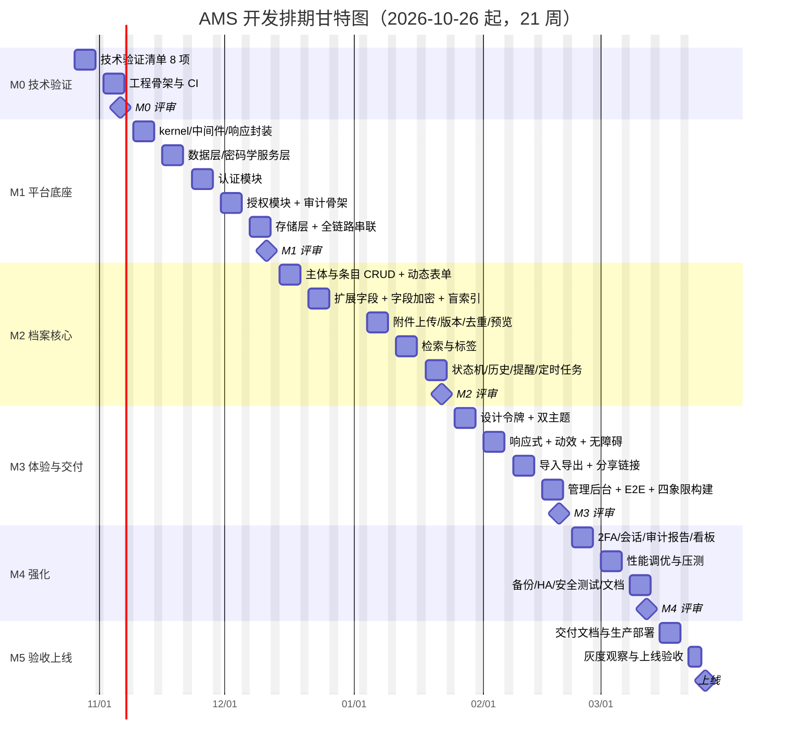

# 05 · 开发排期与里程碑

**项目**：个人档案管理系统（AMS）
**版本**：v0.1（设计基线）
**日期**：2026-10-24
**基准日**：2026-10-26（周一）开工
**关联**：`01-PRD-产品需求文档.md`、`02-架构设计说明.md`

---

## 目录

1. [排期假设与团队配置](#1-排期假设与团队配置)
2. [里程碑总览](#2-里程碑总览)
3. [分阶段迭代计划](#3-分阶段迭代计划)
4. [甘特图](#4-甘特图)
5. [关键路径与依赖](#5-关键路径与依赖)
6. [风险清单与应对](#6-风险清单与应对)
7. [人员分工建议](#7-人员分工建议)
8. [质量门禁与验收流程](#8-质量门禁与验收流程)
9. [变更控制](#9-变更控制)
10. [发布计划](#10-发布计划)

---

## 1. 排期假设与团队配置

### 1.1 基本假设

| 编号 | 假设 | 若不成立 |
| --- | --- | --- |
| P-01 | 团队 5 人：后端 2（含 1 架构）、前端 1、测试 1、PM/设计 0.5（兼） | 工期按比例延长，见 §1.3 |
| P-02 | 每人每周有效开发时间 4 天（扣除会议、评审、支持） | 有效工时下降 20% |
| P-03 | 工期 21 周（2026-10-26 起至 2027-03-26 上线），含 2 周浮动缓冲 | 见 §4 甘特图 |
| P-04 | 甲方需求在 M2 结束时基本冻结，之后只接受 P1 及以下变更 | 变更走 §9 流程，重排后续里程碑 |
| P-05 | openGauss 实例在 M0 即可用；对象存储方案在 M0 末确定 | M0 无法验证则整体后移 1 周 |
| P-06 | 仓颉 SDK 1.1.0 与所需三方库在 M0 验证通过（架构 §12.1 清单） | **这是最大前提**，任一失败则触发技术方案调整 |
| P-07 | 无既有代码可复用（全新项目） | 若可复用前端组件库，M1 可缩短 3–5 天 |
| P-08 | 设计稿在 M2 前可用（PM/设计产出）；M1 先用低保真原型 | 设计延后则 M3 的 UI 细化顺延 |

### 1.2 团队角色

| 角色 | 代号 | 人数 | 主要职责 |
| --- | --- | --- | --- |
| 架构/后端负责人 | BE-1 | 1 | 架构、核心域、密码学、代码评审主力、安全兜底 |
| 后端工程师 | BE-2 | 1 | 业务模块、接口层、数据库、测试 |
| 前端工程师 | FE-1 | 1 | Web 前端、设计令牌实现、动效、E2E |
| 测试工程师 | QA-1 | 1 | 测试设计、自动化、安全用例、验收 |
| PM/设计 | PM-1 | 0.5 | 需求、优先级、原型、视觉稿、验收组织、文档 |

### 1.3 产能与工作量估算

| 项 | 数量 |
| --- | --- |
| P0 需求 | 54 条 |
| P1 需求 | 34 条 |
| P2 需求 | 23 条 |
| P3 需求 | 10 条（本期不做，仅预留） |
| 估算总人日（P0+P1+P2） | ≈ 320 人日 |
| 团队可用人日（21 周 × 5 人 × 4 天/周 × 0.9 有效系数） | ≈ 378 人日 |
| 余量 | ≈ 40 人日（12%），覆盖返工与需求微调 |

> **估算方法**：按功能域粗估（认证 18d / 授权 16d / 档案 32d / 附件 26d / 检索 24d / 标签 6d / 通知 12d / 审计 20d / 导入导出 22d / 系统管理 18d / 基础设施 46d / 联调与缺陷修复 40d / 测试与文档 30d ≈ 310d），加 3% 估算误差。

---

## 2. 里程碑总览

| 里程碑 | 名称 | 周次 | 起止 | 核心交付 | 出口准则（Exit Criteria） |
| --- | --- | --- | --- | --- | --- |
| **M0** | 技术验证与地基 | W1–W2 | 10/26–11/06 | 仓颉/OpenGauss/FFI/ARM 交叉编译全链路验证；工程骨架；CI 流水线；部署脚本雏形 | 架构 §12.1 的 8 项验证清单**全部通过**；CI 可在 4 个平台组合产出可运行二进制；Hello World + 连库 + 加解密 + 迁移跑通 |
| **M1** | 平台底座与认证授权 | W3–W7 | 11/09–12/11 | 配置/日志/错误/中间件链/数据库层/存储层/密码学服务层；登录注册、会话、RBAC、审计骨架 | 登录/注册/登出/令牌轮换可用；RBAC 生效；审计写入覆盖认证操作；单元覆盖率达标；越权用例全过 |
| **M2** | 档案核心与安全闭环 | W8–W12 | 12/14–01/22 | 档案条目、分类模板、扩展字段、附件上传与版本、字段加密与盲索引、检索、标签、通知 | 核心 P0 功能全部可用；敏感字段明文零落库（抓包+查库双验证）；附件版本与去重生效；检索 P95 达标 |
| **M3** | 体验完善与交付形态 | W13–W16 | 01/25–02/19 | 视觉规范落地、深浅色主题、响应式、批量操作、导入导出、分享链接、权限管理界面 | P0 E2E 20 条全通过；四象限构建产物可运行；Docker Compose 一键起；主题与断点验收通过 |
| **M4** | 强化与高可用 | W17–W19 | 02/22–03/12 | 导入任务、异步导出、2FA、分享加固、审计报告、监控看板、健康检查、性能调优 | 性能指标全部达标；渗透测试无高危；备份恢复演练通过；高可用拓扑验证 |
| **M5** | 验收与上线 | W20 | 03/15–03/26 | 交付文档、部署手册、运维手册、培训材料、上线 | 客户验收通过；生产部署完成；7 天观察期无 P0 缺陷 |

> **缓冲**：M4 与 M5 之间预留 2 周浮动，若 M0 验证失败或需求变更较多则优先压缩 M4 的 P2 范围，而非压缩 M2/M3。

---

## 3. 分阶段迭代计划

### M0 · 技术验证与地基（W1–W2）

| 周 | 后端 | 前端 | 测试 | PM/设计 |
| --- | --- | --- | --- | --- |
| W1 | 验证：仓颉 HTTP、opengauss-driver 连接与事务、SM3/SM4 一致性、FFI 调用与降级 | 工程初始化（Vite + TS + ESLint + Prettier）；CI 骨架 | 测试环境准备（openGauss 容器、测试数据策略） | 确认 Q1–Q6 待确认事项；建立需求追溯矩阵骨架 |
| W2 | 验证：ARM 交叉编译、静态资源托管、任务租约；工程分层骨架落地（7 个包） | 设计令牌系统原型 + 主题切换机制原型 | 测试策略与框架选型（Vitest + Playwright） | 原型走查；M0 评审 |

**M0 交付物**
- [ ] 验证报告（8 项清单，逐项含命令与输出）
- [ ] 可运行的工程骨架（含 7 个包的空壳 + 依赖方向 CI 检查）
- [ ] CI 流水线（lint/test/build 四象限矩阵）
- [ ] 部署脚本雏形（systemd + Dockerfile + compose）
- [ ] 密码学 KAT 向量文件（仓颉与 C++ 共用）
- [ ] 技术选型确认纪要（Q1–Q6 结论）

**M0 风险门禁**：任一验证项失败 → **不进入 M1**，先出降级方案并更新 ADR。

---

### M1 · 平台底座与认证授权（W3–W7）

| 周 | 交付重点 |
| --- | --- |
| W3 | `ams-kernel`（配置/日志/错误/ID/时间）；统一响应封装；错误码映射；健康检查 |
| W4 | `ams-data`（连接池/事务/仓储基类/迁移执行器）；`ams-crypto` Provider 抽象 + 仓颉实现 + C++ 实现 + 一致性 KAT |
| W5 | `ams-security/authn`：注册、登录、口令校验（PBKDF2-HMAC-SM3）、令牌签发与轮换、失败锁定、限流 |
| W6 | `ams-security/authz`：RBAC、权限点、归属判定、分类敏感度；`ams-security/audit`：审计写入 + 哈希链 + 权限隔离 |
| W7 | `ams-storage`：FS 驱动、分片上传、SM3 指纹、加密落盘；`ams-api` 中间件链完整串联；M1 联调与安全测试 |

**M1 交付物**
- [ ] 可登录的最小系统（注册 → 激活 → 登录 → 访问受保护接口 → 审计可见）
- [ ] RBAC 与归属判定（含越权用例 100% 通过）
- [ ] 审计哈希链（含链断检测接口）
- [ ] 密码学 Provider 与 C++ FFI 降级路径
- [ ] 接口契约（OpenAPI v1）与前端 Mock 联调

**验收要点**：令牌重放被检出并全局吊销；SQL 注入用例全过；口令策略生效；审计覆盖率 100%（认证类操作）。

---

### M2 · 档案核心与安全闭环（W8–W12）

| 周 | 交付重点 |
| --- | --- |
| W8 | 档案主体与条目 CRUD；分类模板与字段定义；动态表单渲染（前端）；基础字段存储 |
| W9 | 扩展字段模型（`arc_field_defs` + `arc_item_fields` + 提升列）；字段加密与盲索引；敏感字段脱敏输出 |
| W10 | 附件上传（分片/进度/续传）、SM4-GCM 落盘、指纹去重、版本管理、预览与下载（流式解密） |
| W11 | 检索：全文（tsvector + GIN）、结构化筛选、排序、keyset 分页、盲索引等值检索；标签体系 |
| W12 | 状态机与回收站；条目历史版本；时间线；到期提醒与定时任务（DB 租约）；M2 集成测试与安全测试 |

**M2 交付物**
- [ ] 完整档案 CRUD + 12 分类动态表单
- [ ] 敏感字段端到端加密链路（落库密文、盲索引可检索、默认掩码）
- [ ] 附件上传/版本/去重/预览/下载
- [ ] 检索能力（全文 + 筛选 + 盲索引）
- [ ] 到期提醒跑通

**验收要点**：**抓包 + 查库双验证**敏感数据无明文；单主体 1 万条数据下列表 P95 ≤ 300 ms、检索 P95 ≤ 800 ms；附件 50 MB 上传 ≥ 20 MB/s。

---

### M3 · 体验完善与交付形态（W13–W16）

| 周 | 交付重点 |
| --- | --- |
| W13 | 视觉规范落地：设计令牌完整实现、深浅色主题、字号与间距体系；布局骨架（侧栏/内容/面板） |
| W14 | 响应式断点（4 档）；移动端底部导航；Sheet 与抽屉交互；弹簧动效接入；`prefers-reduced-motion` 降级 |
| W15 | 导入（Excel/CSV 模板 + 预检 + 异步任务）；**导出（同步版：单条目 + 分类批量，加密导出包 + 清单 + 签名 + 二次确认 + 审计）**；分享链接（口令/有效期/水印/撤销） |
| W16 | 权限管理界面；审计查询界面；E2E 20 条补齐；四象限构建产物验证；Docker Compose 一键部署验证 |

**M3 交付物**
- [ ] 深浅色双主题 + 响应式（4 断点）+ 动效达标
- [ ] 导入导出全流程（**导出为同步版**：单条目与分类批量够用即可；异步化与全量导出在 M4）
- [ ] 分享链接全流程（含动态水印）
- [ ] 管理后台（用户、角色、字典、审计）
- [ ] 完整交付形态（4 个平台的二进制 + 多架构镜像）

**验收要点**：TC-E2E-001~016 全绿；主题切换无闪烁；375/768/1280/1920 无横向滚动；`docker compose up` 后 5 分钟内可访问。

---

### M4 · 强化与高可用（W17–W19）

| 周 | 交付重点 |
| --- | --- |
| W17 | 2FA（TOTP）；会话设备管理；审计报告导出；健康看板；告警接入；**导出异步化（任务表 + 进度 + 通知 + 产物过期清理 + 全量导出）** |
| W18 | 性能调优（索引优化、慢 SQL 治理、缓存策略）；并发压测；连接池调优 |
| W19 | 备份与恢复演练；HA 拓扑验证（多副本 + 任务租约 + 审计链一致性）；安全测试与渗透；文档补全 |

**M4 交付物**
- [ ] 性能报告（对照 NFR 全部指标）
- [ ] 渗透测试报告（无高危/严重）
- [ ] 备份恢复演练报告
- [ ] HA 部署验证报告
- [ ] 运维手册、监控告警配置

---

### M5 · 验收与上线（W20）

| 周 | 交付重点 |
| --- | --- |
| W20 | 交付文档定稿；部署手册；培训材料；生产部署；灰度观察；上线验收 |

---

## 4. 甘特图



**关键路径**：`M0 技术验证 → M1 密码学服务层 → M2 字段加密与盲索引 → M3 导入导出（依赖加密）→ M5 上线`。
任何 M0 验证项的延期都会**等量推迟**上线日期。

---

## 5. 关键路径与依赖

### 5.1 内部依赖矩阵

| 被阻塞项 | 依赖项 | 依赖类型 | 风险 |
| --- | --- | --- | --- |
| 动态表单渲染 | 字段定义 API | 数据 | 中（接口未定会导致返工） |
| 敏感字段加密落库 | C++/仓颉密码学 Provider | 技术 | **高**（M0 验证项） |
| 盲索引检索 | 密钥派生 + 归一化规则 | 技术 | 中 |
| 附件版本管理 | 存储抽象 + SM4-GCM 流式 | 技术 | 中 |
| 全文检索 | 中文分词方案确认 | 技术 | **高**（openGauss 中文分词效果需 M0 验证） |
| 导入导出 | 加密导出包 + 签名 | 技术 | 低 |
| 分享水印 | 服务端渲染（图片/PDF） | 技术 | 中（PDF 水印需 C++ 或外部工具） |
| 审计哈希链 | 序列分配 + 并发写入策略 | 技术 | 中 |
| 深色主题 | 设计令牌定义 | 设计 | 低（PM 在 M1 末交付令牌表） |
| E2E 全量 | 四象限部署可用 | 环境 | 中 |

### 5.2 外部依赖

| 依赖 | 用途 | 需最晚到位 | 责任方 | 未到位的影响 |
| --- | --- | --- | --- | --- |
| openGauss 实例（开发/测试/预发） | 数据库 | **M0 W1** | 运维 | 阻塞 M0 验证 |
| openGauss 生产实例 | 生产 | M5 W1 | 客户/运维 | 阻塞上线 |
| 对象存储（或本地 FS 决议） | 附件存储 | M0 W2 | 架构/运维 | 阻塞存储层开发 |
| 域名与 TLS 证书 | 生产访问 | M5 W1 | 运维 | 阻塞上线 |
| 鲲鹏测试机（或 ARM 云主机） | ARM 验证 | M1 W3 | 客户/运维 | ARM 交付风险后移暴露 |
| 视觉设计稿 | UI 落地 | M2 W8 | PM/设计 | UI 细化顺延（低保真可先顶上） |
| 安全评审资源 | 上线前评审 | M4 W3 | 安全负责人 | 阻塞上线 |

### 5.3 M0 必须验证的 8 项

> ⚠️ **第 3 项已被本机实测证伪**（见架构 §2.1.1）：SDK 1.0.5 标准库**不含国密实现**，`std.crypto.digest`/`std.crypto.cipher` 只有接口。因此该项已改写为「双路径验证」。同时新增第 9、10 项（本机实测暴露的环境约束）。

| # | 能力 | 通过标准 | 若失败 | 状态 |
| --- | --- | --- | --- | --- |
| 1 | 仓颉 HTTP 服务 | 500 并发连接无异常 | 评估是否改用 C++ HTTP 库或换栈 | ⬜ 待验 |
| 2 | 仓颉 → openGauss | 100 并发无连接泄漏 | 评估 JDBC 旁车方案 | ⬜ 待验 |
| 3 | **国密能力** | stdx 的 SM3/SM4 可用且**与国标标准向量逐字节一致** | 走 C++ OpenSSL 插件（`ams-crypto` 的仓颉实现退化为接口声明 + SecureRandom） | ✅ **已通过**（stdx v1.0.5.1，14 项验证全过） |
| 4 | C++ FFI 与降级 | 拔掉 `.so` 仍能启动 | 重做 FFI 绑定 | ⬜ 待验 |
| 5 | ARM 交叉编译 | 产物可在 ARM 运行（`file` 校验架构） | 引入 ARM CI runner 或放弃 ARM 交付 | ⬜ 待验 |
| 6 | 静态资源托管 | 浏览器验证通过 | 改回 Nginx 独立托管 | ⬜ 待验 |
| 7 | 定时任务租约 | 多实例只执行一次 | 引入独立调度器 | ⬜ 待验 |
| 8 | Excel 解析 | 1 万行 < 5 s | 改用 C++ 或纯 CSV | ⬜ 待验 |
| 9 | **stdx 获取与配置** | 已安装 v1.0.5.1 到 `E:/CangjieLibs/`，`CANGJIE_STDX` 已设，`cjpm.toml` 的 `bin-dependencies.path-option` 已验证 | 全面转 C++ 插件 + 自研 HTTP 层 | ✅ **已通过** |
| 10 | **构建环境可用性** | 至少 `cjc` 能编译并产出可执行文件（`cjpm` 非必需） | 本机 `cjpm` 崩溃（堆损坏，与路径/版本/工程结构均无关）→ **本机统一用 `cjc`**，CI 用 `cjpm` | 🟡 **已降级为 cjc 方案**（SDK 已迁至 `E:/Cangjie` 无空格路径） |

> **第 9 项已闭环**（2026-10-24 完成：stdx v1.0.5.1 安装 + `CANGJIE_STDX` 设置 + 14 项验证全过）。**第 10 项已降级处理** —— SDK 已迁至 `E:/Cangjie`（无空格路径），但 `cjpm` 仍崩溃（堆损坏，与路径无关，属 cjpm 1.0.5 的 Windows 兼容性问题）。**本机统一用 `cjc` 验证代码，`cjpm` 留给 CI**。
>
> **新增工程化产物**：`scripts/envsetup.sh`（环境装载）、`scripts/install-stdx.sh`（可复现安装）、`scripts/verify-stdx.sh`（14 项国密验证）。三者已实测跑通。

---

## 6. 风险清单与应对

| ID | 风险 | 概率 | 影响 | 等级 | 触发信号 | 应对措施 | 责任人 | 应对窗口 |
| --- | --- | --- | --- | --- | --- | --- | --- | --- |
| R-01 | 仓颉生态缺失导致关键功能无法实现 | 高 | 高 | 🔴 | M0 验证项失败 | ① 缺失能力收敛到 C++；② 依赖 vendor 化；③ 准备自研替代 | BE-1 | M0–M1 |
| R-02 | opengauss-driver 成熟度不足 | 中 | 高 | 🟠 | 出现阻塞性缺陷 / 上游 2 周无响应 | ① 仓储层自研接口隔离；② 提 upstream issue；③ JDBC 旁车兜底 | BE-2 | 全程 |
| R-03 | 鲲鹏 ARM 兼容性问题 | 中 | 高 | 🟠 | ARM 构建失败 / 运行崩溃 | ① M0 建 ARM CI；② 尽早真实机验证；③ OpenSSL 用系统包 | BE-1 | M0–M1 |
| R-04 | 中文全文检索质量不达标 | 中 | 中 | 🟡 | 召回率低于预期 | ① M0 验证；② 词典扩展；③ 预留 ES 适配器 | BE-2 | M0 / M2 |
| R-05 | 需求蔓延（甲方持续加需求） | 高 | 中 | 🟠 | 迭代中新增 P0 | ① 需求冻结线设在 M2 末；② 变更走 §9 流程并换出等量范围 | PM-1 | 全程 |
| R-06 | 关键人员流失 | 低 | 高 | 🟠 | 离职/长期请假 | ① 文档即代码（规范 + ADR）；② 至少 2 人熟悉每个关键模块；③ 交叉 review | PM-1 | 全程 |
| R-07 | 安全漏洞在上线前未被发现 | 中 | 高 | 🟠 | 渗透测试发现高危 | ① M1 起安全用例随开发写；② M4 预留渗透测试预算与窗口；③ 灰度期可回滚 | BE-1 / QA-1 | M1–M4 |
| R-08 | 性能指标不达标（尤其检索） | 中 | 中 | 🟡 | 压测 P95 超标 | ① M2 起每迭代跑基准；② 索引与分页策略前置设计；③ 预留 ES 升级路径 | BE-2 | M2–M4 |
| R-09 | 审计表增长导致查询劣化 | 中 | 中 | 🟡 | 审计查询 > 2 s | ① 按月分区（已设计）；② 归档策略；③ 冷热分离 | BE-2 | M2–M4 |
| R-10 | 交付形态在客户现场部署失败 | 中 | 高 | 🟠 | 客户反馈无法启动 | ① 交付**预编译产物**，客户零编译；② 依赖随包分发；③ 离线安装包 | BE-1 / PM-1 | M4–M5 |
| R-11 | 设计与实现脱节 | 中 | 低 | 🟢 | 验收阶段大面积返工 | ① M3 W13–14 集中做视觉落地；② 组件库与令牌先行；③ 每周设计走查 | PM-1 / FE-1 | M3 |
| R-12 | 第三方库许可证不兼容 | 低 | 中 | 🟡 | 引入 GPL 库 | ① 依赖准入检查许可证；② 优先宽松许可（MIT/Apache/MulanPSL） | PM-1 | 全程 |
| R-13 | 测试数据不足导致边界场景漏测 | 中 | 中 | 🟡 | 缺陷集中在边界 | ① 数据工厂生成；② 边界专项用例集；③ Fuzz 目标（JSON/SQL 参数） | QA-1 | 全程 |
| R-14 | 哈希链在多副本下不一致 | 中 | 中 | 🟡 | 链校验失败告警 | ① leader 批量写 + DB 序列；② HA 拓扑专项验证；③ 必要时升级为独立审计服务 | BE-1 | M4 |
| R-15 | **国密在仓颉标准库不可用**（实测证伪） | ~~高~~ → **已缓解** | 高 | 🟢→🟡 | 已装 stdx v1.0.5.1，SM3/SM4 与国标向量一致 | ① 已采用 stdx 为主实现；② C++ 插件降为性能路径；③ **残留风险**：stdx 依赖 OpenSSL 3.x，部署环境需保证 `libssl`/`libcrypto` 版本一致（否则运行时符号缺失） | BE-1 / 运维 | 持续（转为部署期检查项） |
| R-16 | **`cjpm` 在本机崩溃**（堆损坏 `0xC0000374`），已排除路径/版本/工程结构/工程内容四类因素 | 高 | 中 | 🟠 | 实测：换到 `E:/Cangjie` 无空格路径后仍崩；`cjpm init` 可用但 `build` 崩；`cjc` 全程正常 | ① **本机统一用 `cjc`** 直接编译验证；② CI 用标准 Linux 环境跑 `cjpm`；③ 必要时换 SDK 版本复测 | BE-1 / 运维 | **M0 W1**（已降级处理） |

---

## 7. 人员分工建议

### 7.1 RACI 矩阵

> R = 负责执行；A = 最终负责（唯一）；C = 被咨询；I = 被告知

| 工作项 | BE-1 | BE-2 | FE-1 | QA-1 | PM-1 |
| --- | --- | --- | --- | --- | --- |
| 技术选型与 ADR | **A/R** | C | C | C | C |
| 架构与分层设计 | **A/R** | C | I | I | I |
| 密码学与密钥管理 | **A/R** | C | I | C | I |
| 认证授权模块 | **A/R** | R | C | C | I |
| 档案域与数据模型 | **A** | **R** | C | C | I |
| 存储与附件 | C | **R** | C | C | I |
| 检索实现 | C | **R** | C | C | I |
| 前端框架与工程 | C | C | **A/R** | C | C |
| 设计令牌与主题 | C | I | **R** | C | **A** |
| 视觉稿 | I | I | C | I | **A/R** |
| 接口契约定义 | **A** | R | C | C | I |
| 测试设计与自动化 | C | C | C | **A/R** | C |
| 安全测试与渗透 | **A/R** | C | C | R | I |
| 性能测试 | R | R | C | **A** | I |
| 部署与交付 | R | C | I | I | **A** |
| 需求管理 | C | C | C | C | **A/R** |
| 验收组织 | C | C | C | R | **A/R** |

### 7.2 技能矩阵与备份

| 人员 | 主技能 | 备份人 | 备份触发条件 |
| --- | --- | --- | --- |
| BE-1（架构/密码学） | 仓颉、密码学、安全、openGauss | BE-2 | BE-1 缺席 > 3 天 |
| BE-2（业务/数据） | 仓颉、SQL、附件与检索 | BE-1 | BE-2 缺席 > 3 天 |
| FE-1（前端） | Vue 3、TS、设计令牌、动效、E2E | PM-1（仅维护） | FE-1 缺席 > 5 天 |
| QA-1（测试） | 自动化测试、安全用例、性能测试 | BE-2 | QA-1 缺席 > 3 天 |
| PM-1（PM/设计） | 需求、原型、视觉、文档 | BE-1 | PM-1 缺席 > 5 天 |

> **纪律**：每个关键模块至少 2 人能读懂代码；密码学与安全模块**必须**有 BE-1 之外的第二人熟悉（避免单点）。

### 7.3 关键模块的结对安排

| 时段 | 结对内容 |
| --- | --- |
| M0 全程 | BE-1 + BE-2（架构与验证必须双人，避免单点盲区） |
| M1 W5–W7 | BE-1 + BE-2（认证与授权双人实现，双人评审） |
| M2 W9 | BE-1 + BE-2（字段加密与盲索引，双人实现） |
| M4 W19 | 全体（HA 验证与安全测试全员参与） |

---

## 8. 质量门禁与验收流程

### 8.1 门禁清单

| 门禁 | 位置 | 通过条件 |
| --- | --- | --- |
| G1 代码合并 | PR | CI 全绿 + 评审通过（安全模块需 2 人） |
| G2 里程碑出口 | M1–M5 | 出口准则全部满足 + 演示通过 |
| G3 版本发布 | Tag | 四象限构建绿 + 全部测试绿 + 覆盖率达标 + 安全扫描无高危 + 产物签名通过 |
| G4 上线 | 生产 | 预发验证通过 + 备份就绪 + 回滚方案就绪 + 灰度观察通过 |

### 8.2 缺陷分级与响应

| 级别 | 定义 | 修复时限 | 阻断发布 |
| --- | --- | --- | --- |
| P0 致命 | 系统不可用 / 数据丢失 / 安全漏洞 | 4 小时内响应，24 小时内修复 | ✅ |
| P1 严重 | 核心功能不可用 / 绕过权限 | 1 个工作日 | ✅ |
| P2 一般 | 次要功能异常 / 体验问题 | 3 个工作日 | ❌ |
| P3 轻微 | 文案 / 样式细节 | 下个迭代 | ❌ |

### 8.3 验收流程（每里程碑）

```
里程碑演示（PM 主持）
  → 按出口准则逐条核对（记录人：QA-1）
  → 需求覆盖核对（追溯矩阵逐条标注 已实现/部分/未实现）
  → 缺陷分级与录入
  → 里程碑评审会（客户 + PM + 架构）
  → 结论：通过 / 有条件通过（列出待办）/ 不通过（回到当前里程碑）
```

---

## 9. 变更控制

### 9.1 变更分级

| 级别 | 定义 | 审批 | 对排期影响 |
| --- | --- | --- | --- |
| 重大 | 新增业务域、改变技术栈、改变安全等级 | 客户 + 架构 + PM | 需重排里程碑 |
| 中等 | 新增 P0 功能、修改已冻结需求的语义 | 客户 + PM | 需换出等量范围 |
| 轻微 | 新增 P1/P2、文案与样式调整 | PM | 吸收到当前迭代余量 |
| 缺陷修复 | 不改变需求语义 | 架构 | 不影响 |

### 9.2 变更流程

```
提出 → 填写变更申请（背景/范围/收益/代价/工时/风险）
  → 架构评估（技术可行性 + 安全影响 + 对既有设计的影响）
  → 商务与范围确认（是否换出等量工作）
  → 批准 → 更新 PRD/ADR/追溯矩阵/排期 → 实施
```

**冻结线**：M2 结束前接受 P0 新增；M3 结束前接受 P1；之后仅接受缺陷修复与轻微变更。

---

## 10. 发布计划

### 10.1 版本号规范

采用语义化版本 `MAJOR.MINOR.PATCH`：
- **MAJOR**：不兼容的 API 变更或架构重构
- **MINOR**：向后兼容的新功能
- **PATCH**：向后兼容的缺陷修复

预发布标识：`1.0.0-rc.1`、`1.0.0-beta.2`。

### 10.2 发布节奏

| 阶段 | 内容 |
| --- | --- |
| 内部版（`alpha`） | 每日合并到 `develop` 的自动部署，仅开发环境 |
| 集成版（`beta`） | 每周五从 `develop` 切 `release/x.y`，测试环境部署 |
| 候选版（`rc`） | M3–M4 期间，每两周一个 rc，预发环境部署 + 性能与安全测试 |
| 正式版（`x.y.z`） | M5 从 `release/x.y` 切 `main`，打签名 Tag |

### 10.3 灰度与回滚

| 项 | 策略 |
| --- | --- |
| 灰度 | 先内部用户 → 5% → 20% → 100%（按用户 ID 哈希分桶） |
| 回滚触发 | P0 缺陷 / 核心接口错误率 > 1% / 关键性能指标劣化 > 20% |
| 回滚方式 | 二进制回滚（保留上一版本产物）+ 数据库迁移**只向前兼容**（不写破坏性迁移直到稳定） |
| 数据回滚 | 依赖备份恢复（RPO ≤ 5 min）；审计表不参与回滚（只增不减） |

---

## 附录 · 修订记录

| 版本 | 日期 | 修订人 | 变更 |
| --- | --- | --- | --- |
| v0.1 | 2026-10-24 | PM 组 | 首版：6 个里程碑、21 周甘特（2026-10-26~2027-03-26）、8 项 M0 验证门禁、14 项风险、RACI 与结对安排、变更控制与灰度计划 |
