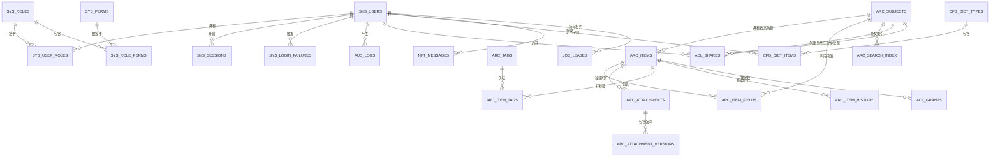

# 06 · 数据模型设计

**项目**：个人档案管理系统（AMS）
**版本**：v0.1（设计基线）
**日期**：2026-10-24
**数据库**：openGauss 5.0 LTS（兼容 3.0 / 6.0）
**关联**：`01-PRD-产品需求文档.md`、`02-架构设计说明.md`、`03-安全设计专章.md`

---

## 目录

1. [设计原则与总览](#1-设计原则与总览)
2. [命名与类型规范](#2-命名与类型规范)
3. [实体关系总览](#3-实体关系总览)
4. [核心实体详细设计](#4-核心实体详细设计)
5. [索引设计](#5-索引设计)
6. [档案扩展字段模型](#6-档案扩展字段模型)
7. [附件与影像实体](#7-附件与影像实体)
8. [检索与标签](#8-检索与标签)
9. [授权与分享](#9-授权与分享)
10. [审计与通知](#10-审计与通知)
11. [字典与枚举规范](#11-字典与枚举规范)
12. [初始化数据](#12-初始化数据)
13. [完整 DDL 清单](#13-完整-ddl-清单)
14. [数据生命周期与分区](#14-数据生命周期与分区)
15. [数据模型取舍记录](#15-数据模型取舍记录)

---

## 1. 设计原则与总览

### 1.1 设计原则

| 编号 | 原则 | 落地方式 |
| --- | --- | --- |
| M-01 | **单一数据源**：一个字段只在一个地方定义 | 扩展字段定义在 `arc_field_defs`，值在 `arc_field_values`，不重复存两份 |
| M-02 | **密文与明文分离**：加密列与索引列并存但职责不同 | `xxx_enc` 存密文，`xxx_bidx` 存盲索引（32 字节定长） |
| M-03 | **归属可强制**：任何业务数据都能追到主体 | 所有业务表带 `subject_id`，且为**非空** |
| M-04 | **软删除优先**：可恢复优于不可逆 | 业务表带 `deleted_at`；物理清理由后台任务执行 |
| M-05 | **审计不可变**：审计表只增不改 | 应用账号仅有 INSERT/SELECT 权限 |
| M-06 | **枚举用码不用字**：字典表 + 数值码 | 避免字符串散落与语义漂移 |
| M-07 | **扩展优先，破坏收敛**：新增字段不改表结构 | 动态字段进 JSONB；稳定后再提升为真实列 |
| M-08 | **时间统一**：一律 `TIMESTAMPTZ`，存 UTC | 展示层本地化 |
| M-09 | **ID 全局唯一**：雪花 ID | 无中心发号器，天然分布式安全 |
| M-10 | **无物理外键**：逻辑外键 + 定期校验 | 避免锁竞争与级联删除的不可控 |

### 1.2 Schema 划分

| Schema | 内容 | 访问账号权限 |
| --- | --- | --- |
| `public` | 业务表（档案、附件、授权、配置） | 应用账号 DML |
| `audit` | 审计表 | 应用账号 **仅 INSERT + SELECT** |
| `ops` | 运维表（任务租约、迁移记录、迁移状态） | 应用账号 DML（受限） |

> 分 Schema 的目的：审计表的权限可以与业务表**物理隔离**，即使应用账号被攻破也无法 UPDATE/DELETE 审计表。openGauss 支持 Schema 级权限隔离。

---

## 2. 命名与类型规范

### 2.1 命名

| 对象 | 规范 | 示例 |
| --- | --- | --- |
| 表 | `snake_case` 复数，带域前缀 | `arc_items`、`aud_logs` |
| 列 | `snake_case` | `subject_id` |
| 主键 | `id` | `id` |
| 布尔 | `is_` 前缀 | `is_active` |
| 时间 | `_at` 后缀 | `created_at`、`expired_at` |
| 计数 | `_count` 后缀 | `attachment_count` |
| 密文列 | `_enc` 后缀 | `id_card_enc` |
| 盲索引列 | `_bidx` 后缀 | `id_card_bidx` |
| 枚举列 | `_<语义>` + 类型 SMALLINT | `status`、`category` |
| 外键列 | `<引用表语义>_id` | `subject_id`、`role_id` |
| 索引 | `idx_<表>_<列...>` | `idx_arc_items_subject_category` |
| 唯一索引 | `uk_<表>_<列...>` | `uk_sys_users_username` |
| 检查约束 | `ck_<表>_<语义>` | `ck_arc_items_status` |
| 注释 | 表级 + 列级 `COMMENT` | 必填 |

### 2.2 类型映射

| 业务类型 | openGauss 类型 | 说明 |
| --- | --- | --- |
| ID | `BIGINT` | 雪花 ID，JS 侧以字符串传输 |
| 短文本 | `VARCHAR(n)` | 明确长度上限 |
| 长文本 | `TEXT` | 仅用于 > 500 字符且不常查询的字段 |
| 小整数 / 枚举 | `SMALLINT` | 枚举用码 |
| 整数 | `INTEGER` | 计数 |
| 长整数 | `BIGINT` | 时间戳（毫秒）等 |
| 金额 | `NUMERIC(18,2)` | 禁止 float |
| 布尔 | `BOOLEAN` | |
| 日期 | `DATE` | 无时间部分（如出生日期） |
| 时间戳 | `TIMESTAMPTZ` | 统一 UTC |
| 字节 | `BYTEA` | 密文、盲索引、哈希 |
| JSON | `JSONB` | 动态字段、审计详情 |
| 数组 | `TEXT[]` / `BIGINT[]` | 多值字段 |

### 2.3 通用列规范

**所有业务表**（`arc_*`、`cfg_*`、`nft_*`）必带：

| 列 | 类型 | 说明 |
| --- | --- | --- |
| `id` | `BIGINT PRIMARY KEY` | 雪花 ID |
| `created_at` | `TIMESTAMPTZ NOT NULL DEFAULT now()` | 创建时间 |
| `created_by` | `BIGINT` | 创建者（可空表示系统） |
| `updated_at` | `TIMESTAMPTZ NOT NULL DEFAULT now()` | 更新时间 |
| `updated_by` | `BIGINT` | 更新者 |
| `version` | `INTEGER NOT NULL DEFAULT 1` | 乐观锁 |
| `deleted_at` | `TIMESTAMPTZ` | 软删除标记 |

---

## 3. 实体关系总览



**核心域划分**：

| 域 | 表前缀 | 职责 |
| --- | --- | --- |
| 账号与权限 | `sys_` | 用户、角色、权限、会话、登录失败、黑名单 |
| 档案主体 | `arc_` | 主体、条目、字段、附件、标签、历史、索引 |
| 授权与分享 | `acl_` | 授权、分享链接、访问记录 |
| 配置与字典 | `cfg_` | 字典、策略配置、分类模板 |
| 审计 | `aud_` | 审计日志、链头锚定 |
| 通知 | `nft_` | 站内通知、通知偏好 |
| 运维 | `job_` | 任务租约、任务运行记录、迁移记录 |

---

## 4. 核心实体详细设计

### 4.1 账号与权限域

#### sys_users（用户）

| 列 | 类型 | 约束 | 说明 |
| --- | --- | --- | --- |
| id | BIGINT | PK | 雪花 ID |
| username | VARCHAR(64) | NOT NULL，UNIQUE | 登录名，全局唯一，小写规范化存储 |
| email | VARCHAR(256) | UNIQUE（可空） | 邮箱，规范化后存储（转小写） |
| email_enc | BYTEA | | 邮箱密文（防枚举） |
| phone | VARCHAR(32) | UNIQUE（可空） | 手机号（明文用于登录匹配；如需更强保护见 §15 取舍 3） |
| phone_bidx | BYTEA(32) | | 手机号盲索引 |
| password_hash | VARCHAR(255) | NOT NULL | PBKDF2-HMAC-SM3 编码串 |
| password_updated_at | TIMESTAMPTZ | | 口令更新时间 |
| nickname | VARCHAR(64) | | 显示名 |
| avatar_file_id | BIGINT | | 头像附件引用 |
| status | SMALLINT | NOT NULL DEFAULT 0 | 0=pending 1=active 2=locked 3=locked_perm 4=pending_delete 5=deleted |
| failed_attempts | INTEGER | NOT NULL DEFAULT 0 | 连续失败次数 |
| locked_until | TIMESTAMPTZ | | 锁定到期时间 |
| last_login_at | TIMESTAMPTZ | | 最近登录时间 |
| last_login_ip | VARCHAR(45) | | 最近登录 IP |
| two_factor_enabled | BOOLEAN | NOT NULL DEFAULT false | 2FA 是否启用 |
| two_factor_secret_enc | BYTEA | | TOTP 密钥密文 |
| kdf_cost | INTEGER | NOT NULL DEFAULT 600000 | 本用户的 PBKDF2 迭代次数（自适应） |
| perm_version | INTEGER | NOT NULL DEFAULT 1 | 权限版本号（变更即 +1，用于缓存失效） |
| created_at / created_by / updated_at / updated_by / version / deleted_at | | | 通用列 |

索引：
- `uk_sys_users_username` UNIQUE(username)
- `uk_sys_users_email` UNIQUE(email)
- `uk_sys_users_phone` UNIQUE(phone)
- `idx_sys_users_status` (status, locked_until)

#### sys_perms（权限点）

| 列 | 类型 | 说明 |
| --- | --- | --- |
| id | BIGINT PK | |
| code | VARCHAR(96) NOT NULL UNIQUE | 权限码，如 `archive:read:own` |
| name | VARCHAR(64) NOT NULL | 权限名称 |
| domain | VARCHAR(32) NOT NULL | 域：archive/attachment/auth/acl/audit/cfg/user/system |
| action | VARCHAR(32) NOT NULL | 动作：read/write/delete/export/manage/audit |
| scope | VARCHAR(16) | 范围：own/any/subject/分类码 |
| is_sensitive | BOOLEAN NOT NULL DEFAULT false | 是否敏感权限（授予需审计） |
| description | VARCHAR(256) | 说明 |

#### sys_roles（角色）

| 列 | 类型 | 说明 |
| --- | --- | --- |
| id | BIGINT PK | |
| code | VARCHAR(64) NOT NULL UNIQUE | `owner`/`curator`/`family`/`org_admin`/`auditor`/自定义 |
| name | VARCHAR(64) NOT NULL | |
| is_builtin | BOOLEAN NOT NULL DEFAULT false | 内置角色不可删除 |
| description | VARCHAR(256) | |
| max_data_level | SMALLINT | 数据可见上限：1=仅本人 2=本人+被授权 3=全部（普通档案） |

#### sys_user_roles / sys_role_perms（关联表）

| 表 | 列 | 说明 |
| --- | --- | --- |
| `sys_user_roles` | id, user_id, role_id, subject_id（可空）, granted_by, granted_at, expires_at | `subject_id` 用于"仅代管某主体"的角色绑定 |
| `sys_role_perms` | id, role_id, perm_id | 角色-权限映射 |

索引：`uk_sys_user_roles` UNIQUE(user_id, role_id, subject_id)；`uk_sys_role_perms` UNIQUE(role_id, perm_id)

#### sys_sessions（会话）

| 列 | 类型 | 说明 |
| --- | --- | --- |
| id | BIGINT PK | |
| session_id | VARCHAR(64) NOT NULL UNIQUE | 会话标识（sid） |
| user_id | BIGINT NOT NULL | |
| refresh_token_bidx | BYTEA(32) NOT NULL | 刷新令牌摘要（**不存原文**） |
| refresh_prev_bidx | BYTEA(32) | 上一代刷新令牌摘要（用于重放检测） |
| refresh_expires_at | TIMESTAMPTZ NOT NULL | |
| device_id | VARCHAR(128) | 设备标识 |
| device_name | VARCHAR(128) | 设备名（解析自 UA） |
| client_ip | VARCHAR(45) | |
| user_agent | VARCHAR(256) | |
| ip_prefix | VARCHAR(64) | IP 段（用于异常判定） |
| last_active_at | TIMESTAMPTZ NOT NULL | |
| revoked_at | TIMESTAMPTZ | 撤销时间 |
| revoke_reason | VARCHAR(64) | 原因（logout/password_change/admin/replay） |

索引：`uk_sys_sessions_session_id`；`idx_sys_sessions_user` (user_id, revoked_at)；`uk_sys_sessions_refresh_bidx` UNIQUE(refresh_token_bidx)

#### sys_login_failures（登录失败记录）

| 列 | 类型 | 说明 |
| --- | --- | --- |
| id | BIGINT PK | |
| user_ref | VARCHAR(128) | 用户名或标识（用户不存在时为空） |
| client_ip | VARCHAR(45) NOT NULL | |
| user_agent | VARCHAR(256) | |
| reason | VARCHAR(32) NOT NULL | `bad_password`/`no_such_user`/`locked`/`captcha_failed` |
| occurred_at | TIMESTAMPTZ NOT NULL | |

索引：`idx_sys_login_failures_ip` (client_ip, occurred_at)；`idx_sys_login_failures_user` (user_ref, occurred_at)

> **保留期**：仅保留 30 天（用于限流与风控），与审计表分开。

#### sys_ip_blacklist（IP 黑名单）

| 列 | 类型 | 说明 |
| --- | --- | --- |
| id | BIGINT PK | |
| client_ip | VARCHAR(45) NOT NULL | |
| reason | VARCHAR(128) NOT NULL | |
| source | VARCHAR(32) | `auto`/`manual` |
| blocked_until | TIMESTAMPTZ | 为空表示永久 |
| created_by | BIGINT | |

索引：`uk_sys_ip_blacklist` UNIQUE(client_ip, blocked_until)

---

### 4.2 档案主体域

#### arc_subjects（档案主体）

**"主体"是本系统最重要的概念**：一个真实的人（本人、家庭成员、被代管人），其下挂载全部档案条目。

| 列 | 类型 | 约束 | 说明 |
| --- | --- | --- | --- |
| id | BIGINT | PK | 主体 ID |
| name_enc | BYTEA | NOT NULL | 姓名密文 |
| name_bidx | BYTEA(32) | | 姓名盲索引（用于去重与检索） |
| alias | VARCHAR(64) | | 别称（明文，仅内部识别用） |
| relation | SMALLINT | NOT NULL DEFAULT 0 | 与主账号关系：0=本人 1=配偶 2=子女 3=父母 4=其他 |
| gender | SMALLINT | | 0=未知 1=男 2=女 3=其他 |
| birth_date | DATE | | 出生日期 |
| is_primary | BOOLEAN | NOT NULL DEFAULT false | 是否主主体（每个用户仅一个） |
| owner_id | BIGINT | NOT NULL | 主体归属的所有者（用户 ID） |
| custodian_ids | BIGINT[] | | 被授权的代管人用户 ID 数组 |
| status | SMALLINT | NOT NULL DEFAULT 1 | 0=草稿 1=正常 2=已归档 3=已删除 |
| completeness | SMALLINT | NOT NULL DEFAULT 0 | 完整度百分比（0-100），计算后缓存 |
| last_accessed_at | TIMESTAMPTZ | | |
| summary | TEXT | | 摘要（非敏感） |

索引：
- `idx_arc_subjects_owner` (owner_id, status)
- `idx_arc_subjects_name_bidx` (owner_id, name_bidx)
- `idx_arc_subjects_custodian` USING GIN (custodian_ids)

#### arc_items（档案条目）

**核心表**：一条记录 = 一份档案（如"某张学历证书"）。

| 列 | 类型 | 约束 | 说明 |
| --- | --- | --- | --- |
| id | BIGINT | PK | |
| subject_id | BIGINT | NOT NULL | 所属主体 |
| category | SMALLINT | NOT NULL | 分类码（见 §11.2） |
| title | VARCHAR(256) | NOT NULL | 条目标题（用户可编辑，非敏感） |
| title_norm | VARCHAR(256) | | 标题归一化（小写+去空格），用于排序与去重 |
| status | SMALLINT | NOT NULL DEFAULT 1 | 0=draft 1=active 2=archived 3=deleted |
| sensitivity | SMALLINT | NOT NULL DEFAULT 1 | 1=normal 2=sensitive 3=high（继承分类默认，可上调不可下调） |
| issued_date | DATE | | 颁发/生效日期 |
| expires_at | DATE | | 失效日期（触发提醒） |
| issuer | VARCHAR(128) | | 颁发机构 |
| identifier_no_bidx | BYTEA(32) | | 通用编号盲索引（证书号/学号等） |
| identifier_no_enc | BYTEA | | 通用编号密文 |
| tags_count | INTEGER | NOT NULL DEFAULT 0 | 标签数（缓存） |
| attachment_count | INTEGER | NOT NULL DEFAULT 0 | 附件数（缓存） |
| source | SMALLINT | NOT NULL DEFAULT 0 | 0=手工 1=导入 2=API 3=OCR |
| search_vector | TSVECTOR | | 全文检索向量（由触发器/应用维护） |
| extra | JSONB | NOT NULL DEFAULT '{}' | 扩展字段（非敏感部分） |
| remark | TEXT | | 备注（非敏感） |
| source_ref | VARCHAR(128) | | 来源引用（如导入文件名） |

索引：
- `idx_arc_items_subject_cat` (subject_id, category, status, updated_at DESC) —— **主查询路径**
- `idx_arc_items_expires` (expires_at) WHERE status = 1 AND expires_at IS NOT NULL —— 到期扫描
- `idx_arc_items_issuer` (issuer)
- `idx_arc_items_identifier_bidx` (identifier_no_bidx)
- `idx_arc_items_search` USING GIN (search_vector) —— 全文检索
- `idx_arc_items_extra` USING GIN (extra jsonb_path_ops) —— 扩展字段查询
- `idx_arc_items_created` (created_at DESC)

> **主键与分页**：所有列表查询使用 `(updated_at, id)` 或 `(created_at, id)` 复合键做 keyset 分页，索引需与排序键顺序一致。

#### arc_field_defs（字段定义）

定义某个主体（或分类模板）下的扩展字段。

| 列 | 类型 | 说明 |
| --- | --- | --- |
| id | BIGINT PK | |
| subject_id | BIGINT | 为空表示分类模板（内置） |
| category | SMALLINT NOT NULL | 所属分类 |
| field_key | VARCHAR(64) NOT NULL | 字段键（英文，程序使用） |
| field_name | VARCHAR(64) NOT NULL | 字段名（中文，展示用） |
| data_type | SMALLINT NOT NULL | 1=text 2=number 3=date 4=enum 5=multi_enum 6=bool 7=email 8=phone 9=idcard 10=url 11=json |
| sensitivity | SMALLINT NOT NULL DEFAULT 1 | 1=normal 2=sensitive 3=high |
| is_required | BOOLEAN NOT NULL DEFAULT false | |
| is_searchable | BOOLEAN NOT NULL DEFAULT false | 是否进入全文索引 |
| is_filterable | BOOLEAN NOT NULL DEFAULT false | 是否可筛选 |
| is_bidx_capable | BOOLEAN NOT NULL DEFAULT false | 是否支持盲索引等值检索 |
| enum_dict_code | VARCHAR(64) | 当 data_type 为 enum 时关联字典类型 |
| display_order | INTEGER NOT NULL DEFAULT 0 | 展示顺序 |
| validation_rule | JSONB | 校验规则（长度/正则/范围） |
| default_value | TEXT | |
| is_system | BOOLEAN NOT NULL DEFAULT false | 系统内置字段（不可删除，可隐藏） |
| status | SMALLINT NOT NULL DEFAULT 1 | 1=启用 0=停用 |

索引：`uk_arc_field_defs` UNIQUE(subject_id, category, field_key)；`idx_arc_field_defs_cat` (category, display_order)

#### arc_item_fields（条目字段取值）

| 列 | 类型 | 说明 |
| --- | --- | --- |
| id | BIGINT PK | |
| item_id | BIGINT NOT NULL | 所属条目 |
| field_def_id | BIGINT NOT NULL | 字段定义 |
| value_text | TEXT | 文本型值（明文，仅非敏感字段） |
| value_num | NUMERIC(20,6) | 数值型值 |
| value_date | DATE | 日期型值 |
| value_bool | BOOLEAN | 布尔值 |
| value_json | JSONB | 多值/结构型值 |
| value_enc | BYTEA | **敏感字段的密文**（与 value_* 互斥） |
| value_bidx | BYTEA(32) | 敏感字段的盲索引 |
| numeric_value_norm | NUMERIC(20,6) | 数值型字段的**提升列**（用于范围查询与排序） |

索引：
- `uk_arc_item_fields` UNIQUE(item_id, field_def_id)
- `idx_arc_item_fields_def` (field_def_id, value_bidx) —— 盲索引等值查询
- `idx_arc_item_fields_num` (field_def_id, numeric_value_norm) —— 范围查询

> **提升列（promoted column）设计**：动态字段若需要范围查询/排序，仅靠 JSONB 效率不足。做法是把"被筛选/排序使用"的字段值冗余到 `numeric_value_norm`（数值）或 `value_text`（文本）列，并建索引。冗余由应用层在写入时同步。冗余带来一致性风险 → 用 `arc_item_fields` 的唯一约束 + 事务内双写保证；并提供定时校验任务比对 JSONB 与提升列。

#### arc_item_history（条目历史版本）

| 列 | 类型 | 说明 |
| --- | --- | --- |
| id | BIGINT PK | |
| item_id | BIGINT NOT NULL | |
| version_no | INTEGER NOT NULL | 版本号 |
| change_type | SMALLINT NOT NULL | 1=create 2=update 3=status 4=delete 5=restore 6=attach 7=detach |
| changed_fields | JSONB | 变更字段与前后值（**脱敏后**） |
| snapshot | JSONB | 变更前快照（敏感字段存**密文**） |
| operator_id | BIGINT | 操作者 |
| operated_at | TIMESTAMPTZ NOT NULL | |

索引：`uk_arc_item_history` UNIQUE(item_id, version_no)；`idx_arc_item_history_time` (operated_at DESC)

> **保留策略**：仅保留关键字段变更（身份类字段、状态变更、附件变更）；普通备注修改不记快照，避免数据膨胀。保留 2 年。

#### arc_tags（标签）

| 列 | 类型 | 说明 |
| --- | --- | --- |
| id | BIGINT PK | |
| owner_id | BIGINT NOT NULL | 标签所属用户 |
| name | VARCHAR(64) NOT NULL | 标签名 |
| name_norm | VARCHAR(64) NOT NULL | 归一化名（用于去重） |
| color | VARCHAR(16) | 颜色令牌（设计令牌名，非任意色值） |
| category | SMALLINT | 适用分类（为空表示通用） |
| usage_count | INTEGER NOT NULL DEFAULT 0 | 使用次数 |
| last_used_at | TIMESTAMPTZ | |
| parent_id | BIGINT | 父标签（层级） |

索引：`uk_arc_tags` UNIQUE(owner_id, name_norm, parent_id)；`idx_arc_tags_usage` (owner_id, usage_count DESC)

#### arc_item_tags（条目-标签关联）

| 列 | 类型 | 说明 |
| --- | --- | --- |
| id | BIGINT PK | |
| item_id | BIGINT NOT NULL | |
| tag_id | BIGINT NOT NULL | |
| created_at | TIMESTAMPTZ NOT NULL | |

索引：`uk_arc_item_tags` UNIQUE(item_id, tag_id)；`idx_arc_item_tags_tag` (tag_id)

---

### 4.3 分类模板（内置字段定义）

内置 12 个分类的字段模板以 `arc_field_defs` 中 `subject_id IS NULL` 的记录存在（见 §12.2）。

---

## 5. 索引设计

### 5.1 索引策略

| 原则 | 说明 |
| --- | --- |
| 组合索引**最左前缀**匹配查询 | 索引列顺序 = 查询条件顺序（等值列在前，范围/排序列在后） |
| 覆盖排序 | 列表查询的排序键必须在索引末尾，避免排序额外扫描 |
| 部分索引 | 高频过滤条件用 `WHERE` 限定（如仅索引未删除记录） |
| 避免过度索引 | 每个索引都有写入成本；单表索引数 ≤ 8 |
| GIN 用于数组/JSONB/全文 | `search_vector`、`extra`、`custodian_ids` |
| HASH 用于定长高基数字段 | 盲索引列（32 字节） |
| 不为低区分度单列建索引 | 如 `status`、`category` 单独不建索引 |

### 5.2 索引清单

| 表 | 索引名 | 类型 | 列 | 用途 |
| --- | --- | --- | --- | --- |
| sys_users | uk_sys_users_username | UNIQUE | username | 登录 |
| sys_users | uk_sys_users_email | UNIQUE | email | 唯一性校验 |
| sys_users | uk_sys_users_phone | UNIQUE | phone | 唯一性校验 |
| sys_users | idx_sys_users_status | BTREE | status, locked_until | 锁定扫描 |
| sys_sessions | uk_sys_sessions_session_id | UNIQUE | session_id | 会话查询 |
| sys_sessions | uk_sys_sessions_refresh_bidx | UNIQUE | refresh_token_bidx | 令牌校验 |
| sys_sessions | idx_sys_sessions_user | BTREE | user_id, revoked_at | 用户会话列表 |
| sys_login_failures | idx_sys_login_failures_ip | BTREE | client_ip, occurred_at | 限流与风控 |
| arc_subjects | idx_arc_subjects_owner | BTREE | owner_id, status | 我的主体列表 |
| arc_subjects | idx_arc_subjects_name_bidx | BTREE | owner_id, name_bidx | 姓名去重 |
| arc_subjects | idx_arc_subjects_custodian | GIN | custodian_ids | 代管人查询 |
| arc_items | idx_arc_items_subject_cat | BTREE | subject_id, category, status, updated_at DESC | **主列表查询** |
| arc_items | idx_arc_items_expires | BTREE | expires_at) WHERE status=1 AND expires_at IS NOT NULL | 到期扫描 |
| arc_items | idx_arc_items_identifier_bidx | BTREE | identifier_no_bidx | 编号精确查 |
| arc_items | idx_arc_items_issuer | BTREE | issuer | 机构筛选 |
| arc_items | idx_arc_items_search | GIN | search_vector | 全文检索 |
| arc_items | idx_arc_items_extra | GIN | extra jsonb_path_ops | 扩展字段查询 |
| arc_item_fields | uk_arc_item_fields | UNIQUE | item_id, field_def_id | 唯一性 |
| arc_item_fields | idx_arc_item_fields_def_bidx | BTREE | field_def_id, value_bidx | 盲索引查询 |
| arc_item_fields | idx_arc_item_fields_num | BTREE | field_def_id, numeric_value_norm | 范围查询 |
| arc_item_history | uk_arc_item_history | UNIQUE | item_id, version_no | 版本唯一 |
| arc_tags | uk_arc_tags | UNIQUE | owner_id, name_norm, parent_id | 标签去重 |
| arc_item_tags | uk_arc_item_tags | UNIQUE | item_id, tag_id | 关联唯一 |
| aud_logs | idx_aud_logs_actor_time | BTREE | actor_id, occurred_at DESC | 审计查询 |
| aud_logs | idx_aud_logs_subject_time | BTREE | subject_id, occurred_at DESC | 按主体审计 |
| aud_logs | idx_aud_logs_action_time | BTREE | action, occurred_at DESC | 按动作审计 |
| aud_logs | idx_aud_logs_time | BTREE | occurred_at DESC | 时间范围 |

> **openGauss 注意事项**：
> - GIN 索引在 openGauss 中主要用于 JSONB 与全文检索；`jsonb_path_ops` 算子类在 openGauss 中的支持情况需在 M0 验证（见 §15 取舍 5）。
> - openGauss 支持 HASH 索引，且对定长列优于 BTREE；但 HASH 索引不支持多列与唯一约束 —— 盲索引列是单列，故适用。
> - 部分索引（`WHERE` 子句）openGauss 支持。

### 5.3 查询模式与索引匹配

| 查询 | SQL 形态 | 命中索引 |
| --- | --- | --- |
| 某主体的某分类列表 | `WHERE subject_id=? AND category=? AND status=1 ORDER BY updated_at DESC, id DESC` | `idx_arc_items_subject_cat` |
| 游标翻页 | `... AND (updated_at, id) < (?, ?)` | 同上（keyset） |
| 到期扫描 | `WHERE expires_at BETWEEN ? AND ? AND status=1` | `idx_arc_items_expires` |
| 全文检索 | `WHERE search_vector @@ to_tsquery(?)` | `idx_arc_items_search` |
| 证件号精确匹配 | `WHERE identifier_no_bidx = ?` | `idx_arc_items_identifier_bidx` |
| 动态字段盲索引 | `JOIN arc_item_fields f ON f.item_id=i.id WHERE f.field_def_id=? AND f.value_bidx=?` | `idx_arc_item_fields_def_bidx` |
| 审计按人查 | `WHERE actor_id=? AND occurred_at > ?` | `idx_aud_logs_actor_time` |

---

## 6. 档案扩展字段模型

### 6.1 三层字段模型

```
┌─ L1 内置列（真实列）───────────────────────────────┐
│  极高频或需强约束的字段：title/issuer/dates/status │
│  优点：类型约束、索引高效、查询快                     │
└────────────────────────────────────────────────────┘
┌─ L2 扩展字段（arc_field_defs + arc_item_fields）────┐
│  分类特有字段：学号/专业/职位/有效期…                  │
│  优点：可自定义、免迁移                             │
└────────────────────────────────────────────────────┘
┌─ L3 动态补充（arc_items.extra JSONB）───────────────┐
│  低频/一次性信息、来源特定的杂项                     │
│  优点：完全不约束                                 │
└────────────────────────────────────────────────────┘
```

### 6.2 字段提升（Promotion）流程

```
分类模板定义 → 分析高频筛选字段 → 提升为 L1/L2 提升列
   ↓
当某字段的筛选使用次数超过阈值（如 50 次/周）或被标记为「需范围查询」
   ↓
① 在 arc_item_fields 增加对应提升列（如 numeric_value_norm）
② 建索引
③ 回填历史数据（迁移脚本）
④ 应用层在写入时同步双写
⑤ 定时校验任务比对一致性（发现漂移则告警并自动修复）
```

### 6.3 敏感字段的存储规则

| 规则 | 说明 |
| --- | --- |
| 敏感字段**必须**用 `value_enc`（密文） | 禁止写 `value_text` |
| 敏感字段**不**写 `extra` JSONB | JSONB 无加密能力，明文会泄漏 |
| 需要检索时用 `value_bidx` | 由 `field_def.is_bidx_capable` 控制 |
| 敏感字段**不**进 `search_vector` | 避免全文索引成为泄漏面 |
| 敏感字段的历史快照也存密文 | `arc_item_history.snapshot` 中的敏感值同样加密 |
| 审计详情中的敏感值脱敏 | 变更审计只记录"字段被修改"，不记录明文前后值 |

---

## 7. 附件与影像实体

### 7.1 arc_attachments（附件逻辑对象）

一个附件可对应多个版本。

| 列 | 类型 | 说明 |
| --- | --- | --- |
| id | BIGINT PK | |
| subject_id | BIGINT NOT NULL | 归属主体 |
| item_id | BIGINT | 所属条目（可空 = 主体级独立附件） |
| category | SMALLINT NOT NULL | 所属分类 |
| title | VARCHAR(256) NOT NULL | 附件标题（用户可编辑） |
| current_version_id | BIGINT | 当前版本 ID |
| version_count | INTEGER NOT NULL DEFAULT 0 | 版本数 |
| storage_key | VARCHAR(512) NOT NULL | 存储对象键（**明文路径不含敏感文件名**） |
| storage_backend | SMALLINT NOT NULL DEFAULT 0 | 0=fs 1=s3 |
| encryption_alg | VARCHAR(16) NOT NULL DEFAULT 'SM4-GCM' | 加密算法标识 |
| key_version | INTEGER NOT NULL | 使用的 DEK 版本 |
| file_size | BIGINT | 当前版本大小 |
| file_ext | VARCHAR(16) | 扩展名 |
| mime_type | VARCHAR(128) | MIME |
| width / height | INTEGER | 图片尺寸 |
| page_count | INTEGER | PDF 页数 |
| sm3_fingerprint | BYTEA(32) | 当前版本 SM3 指纹 |
| dedup_key | VARCHAR(128) | 去重键 = subject_id + sm3 |
| status | SMALLINT NOT NULL DEFAULT 0 | 0=uploading 1=scanning 2=ready 3=quarantined 4=deleted |
| is_current_deleted | BOOLEAN NOT NULL DEFAULT false | 当前版本是否已删（保留逻辑对象） |
| watermark_enabled | BOOLEAN NOT NULL DEFAULT true | 是否加水印 |
| download_count | INTEGER NOT NULL DEFAULT 0 | 下载次数 |
| last_accessed_at | TIMESTAMPTZ | |

索引：
- `idx_arc_attachments_subject` (subject_id, status)
- `idx_arc_attachments_item` (item_id) WHERE status <> 4
- `uk_arc_attachments_dedup` UNIQUE(dedup_key) —— 秒传去重
- `idx_arc_attachments_fingerprint` (sm3_fingerprint)

> **去重策略**：唯一约束建在 `(dedup_key)` 上，其中 `dedup_key = subject_id || ':' || sm3_hex`。**跨主体不复用**（避免通过指纹推断他人文件）。上传时先查 `dedup_key` 命中 → 直接引用已有物理文件。

### 7.2 arc_attachment_versions（附件版本）

| 列 | 类型 | 说明 |
| --- | --- | --- |
| id | BIGINT PK | |
| attachment_id | BIGINT NOT NULL | |
| version_no | INTEGER NOT NULL | 版本号（从 1 递增） |
| storage_key | VARCHAR(512) NOT NULL | 该版本的存储键 |
| file_size | BIGINT NOT NULL | |
| file_ext | VARCHAR(16) | |
| mime_type | VARCHAR(128) | |
| sm3_fingerprint | BYTEA(32) NOT NULL | 该版本指纹 |
| iv | BYTEA(12) | SM4-GCM IV（与密文一同存储或由存储格式自带） |
| is_current | BOOLEAN NOT NULL DEFAULT false | 是否当前版本 |
| status | SMALLINT NOT NULL DEFAULT 0 | 0=uploading 1=scanning 2=ready 3=quarantined 4=superseded 5=deleted |
| change_note | VARCHAR(256) | 变更说明 |
| uploaded_by | BIGINT NOT NULL | |
| uploaded_at | TIMESTAMPTZ NOT NULL | |

索引：`uk_arc_attachment_versions` UNIQUE(attachment_id, version_no)；`idx_arc_attachment_versions_current` (attachment_id) WHERE is_current

> **只追加不覆盖**：新版本上传 → 新增 version 行 → 旧版本 `is_current=false, status=superseded` → 附件的 `current_version_id` 指向新版本。物理字节流在保留期内不删除（用于回滚与举证）。

### 7.3 存储键规则

```
<subject_id>/<yyyy>/<mm>/<attachment_id>/v<version_no>.<ext>

例：100234/2026/10/2003456/v2.jpg
```

**不使用原始文件名**做路径（防路径穿越、防信息泄漏、防编码问题）。原始文件名存于 `arc_attachments.title`（用户可编辑）并保留在 `arc_attachment_versions` 的扩展名字段。

---

## 8. 检索与标签

### 8.1 arc_search_index（检索索引辅助表）

| 列 | 类型 | 说明 |
| --- | --- | --- |
| id | BIGINT PK | |
| item_id | BIGINT NOT NULL | |
| subject_id | BIGINT NOT NULL | |
| category | SMALLINT NOT NULL | |
| content | TEXT NOT NULL | 归一化后的可检索文本 |
| tokens | TEXT[] | 分词结果（便于二次处理） |
| search_vector | TSVECTOR | 全文向量 |
| updated_at | TIMESTAMPTZ NOT NULL | |

索引：`uk_arc_search_index` UNIQUE(item_id)；`idx_arc_search_index_vector` GIN(search_vector)；`idx_arc_search_index_subject` (subject_id, category)

> **为什么独立建表而不是直接在 `arc_items` 上**：`arc_items.search_vector` 只覆盖内置列，扩展字段与附件 OCR 文本需要聚合。独立表便于：① 按分类单独重建索引；② 大规模重建不影响主表；③ 未来可平滑迁移到外部搜索引擎。代价是查询需 JOIN —— 用 `item_id` 唯一索引保证 JOIN 效率。

### 8.2 检索策略

| 查询类型 | 实现 |
| --- | --- |
| 关键词全文 | `arc_search_index.search_vector @@ to_tsquery('simple', ?)` |
| 分类筛选 | `arc_items.category = ?` |
| 标签筛选 | `JOIN arc_item_tags` |
| 扩展字段筛选 | `arc_item_fields.value_bidx` / `numeric_value_norm` / `value_text` |
| 组合 | SQL JOIN + 动态 WHERE（列名走白名单） |
| 排序 | `updated_at / created_at / title_norm / expires_at`，均走索引 |

---

## 9. 授权与分享

### 9.1 acl_grants（授权记录）

| 列 | 类型 | 说明 |
| --- | --- | --- |
| id | BIGINT PK | |
| grantor_id | BIGINT NOT NULL | 授权人 |
| grantee_id | BIGINT | 被授权用户（分享链接时为空） |
| subject_id | BIGINT | 授权主体范围（可空 = 主体内全部） |
| item_id | BIGINT | 精确到条目（可空） |
| category | SMALLINT | 精确到分类（可空） |
| perm_codes | SMALLINT[] | 授予的权限码集合（read/write/export） |
| expires_at | TIMESTAMPTZ | 到期时间（可空 = 永久，但建议必填） |
| revoked_at | TIMESTAMPTZ | 撤销时间 |
| revoke_reason | VARCHAR(128) | |
| status | SMALLINT NOT NULL DEFAULT 1 | 1=生效 2=撤销 3=过期 |

索引：`idx_acl_grants_grantee` (grantee_id, status, expires_at)；`idx_acl_grants_item` (item_id, status)

### 9.2 acl_shares（分享链接）

| 列 | 类型 | 说明 |
| --- | --- | --- |
| id | BIGINT PK | |
| token_bidx | BYTEA(32) NOT NULL UNIQUE | 分享令牌摘要（**不存原文**） |
| owner_id | BIGINT NOT NULL | 创建者 |
| subject_id | BIGINT NOT NULL | 主体 |
| item_id | BIGINT | 精确到条目 |
| category | SMALLINT | 精确到分类 |
| access_password_hash | VARCHAR(255) | 访问口令哈希（可空 = 无口令） |
| expires_at | TIMESTAMPTZ NOT NULL | 有效期 |
| max_access_count | INTEGER | 最大访问次数（可空 = 不限） |
| access_count | INTEGER NOT NULL DEFAULT 0 | 已访问次数 |
| allow_download | BOOLEAN NOT NULL DEFAULT false | 是否允许下载 |
| watermark_enabled | BOOLEAN NOT NULL DEFAULT true | 是否加水印 |
| revoked_at | TIMESTAMPTZ | 撤销 |
| failed_attempts | INTEGER NOT NULL DEFAULT 0 | 口令错误次数 |
| last_accessed_at | TIMESTAMPTZ | |

索引：`uk_acl_shares_token` UNIQUE(token_bidx)；`idx_acl_shares_owner` (owner_id, revoked_at)

### 9.3 acl_share_access_log（分享访问记录）

| 列 | 类型 | 说明 |
| --- | --- | --- |
| id | BIGINT PK | |
| share_id | BIGINT NOT NULL | |
| client_ip | VARCHAR(45) | |
| user_agent | VARCHAR(256) | |
| action | SMALLINT NOT NULL | 1=访问 2=下载 3=口令错误 4=限流拦截 |
| result | SMALLINT NOT NULL | 1=成功 0=失败 |
| occurred_at | TIMESTAMPTZ NOT NULL | |

索引：`idx_acl_share_access_log` (share_id, occurred_at DESC)

> 访问日志也可合并入 `aud_logs`（action=`share.access`）。独立表的原因：分享访问是**高频**操作，放审计表会显著增长审计量；独立表 + 定期归档更合适。

---

## 10. 审计与通知

### 10.1 aud_logs（审计日志）

位于 `audit` Schema。

| 列 | 类型 | 说明 |
| --- | --- | --- |
| id | BIGINT PK | 雪花 ID（**时间有序**，便于按 ID 范围归档） |
| trace_id | VARCHAR(32) | 链路 ID |
| occurred_at | TIMESTAMPTZ NOT NULL | 事件时间 |
| actor_id | BIGINT | 操作者（系统动作为空） |
| actor_type | SMALLINT NOT NULL | 0=用户 1=系统 2=匿名 3=服务账号 |
| action | VARCHAR(64) NOT NULL | 动作码 |
| action_desc | VARCHAR(256) | 人类可读描述 |
| target_type | VARCHAR(32) | 目标类型 |
| target_id | VARCHAR(64) | 目标 ID |
| subject_id | BIGINT | 相关主体 |
| result | SMALLINT NOT NULL | 0=成功 1=失败 2=拒绝 |
| error_code | VARCHAR(32) | |
| client_ip | VARCHAR(45) | |
| user_agent | VARCHAR(256) | |
| detail | JSONB | 上下文（**已脱敏**） |
| prev_hash | BYTEA(32) NOT NULL | 前一条哈希 |
| record_hash | BYTEA(32) NOT NULL | 本条哈希 |
| chain_seq | BIGINT NOT NULL | 链序号（DB 序列分配，保证全局有序） |

索引：
- `idx_aud_logs_actor_time` (actor_id, occurred_at DESC)
- `idx_aud_logs_subject_time` (subject_id, occurred_at DESC)
- `idx_aud_logs_action_time` (action, occurred_at DESC)
- `idx_aud_logs_time` (occurred_at DESC)
- `uk_aud_logs_chain_seq` UNIQUE(chain_seq, occurred_at)   ← 唯一约束须含分区键

**权限**：
```sql
REVOKE UPDATE, DELETE, TRUNCATE ON audit.aud_logs FROM ams_app;
REVOKE ALL ON audit.aud_logs FROM PUBLIC;
GRANT SELECT, INSERT ON audit.aud_logs TO ams_app;
```

### 10.2 aud_chain_anchors（链头锚定）

| 列 | 类型 | 说明 |
| --- | --- | --- |
| id | BIGINT PK | |
| anchor_date | DATE NOT NULL UNIQUE | 锚定日期 |
| chain_head_hash | BYTEA(32) NOT NULL | 当日链头哈希 |
| record_count | BIGINT NOT NULL | 当日记录数 |
| anchored_at | TIMESTAMPTZ NOT NULL | 锚定时间 |
| external_ref | VARCHAR(256) | 外部锚定位置（监控系统/文件/独立库引用） |

用途：防止"整链重写"攻击。每日把链头写入此表并额外推送到**主库之外**的位置。

### 10.3 nft_messages（站内通知）

| 列 | 类型 | 说明 |
| --- | --- | --- |
| id | BIGINT PK | |
| receiver_id | BIGINT NOT NULL | 接收人 |
| category | SMALLINT NOT NULL | 1=系统 2=到期提醒 3=授权 4=安全 5=任务 |
| title | VARCHAR(128) NOT NULL | |
| content | TEXT | |
| level | SMALLINT NOT NULL DEFAULT 0 | 0=普通 1=重要 2=紧急 |
| ref_type | VARCHAR(32) | 关联对象类型 |
| ref_id | VARCHAR(64) | 关联对象 ID |
| is_read | BOOLEAN NOT NULL DEFAULT false | |
| read_at | TIMESTAMPTZ | |
| expires_at | TIMESTAMPTZ | |
| created_at | TIMESTAMPTZ NOT NULL | |

索引：`idx_nft_messages_receiver` (receiver_id, is_read, created_at DESC)

### 10.4 job_leases（任务租约）

| 列 | 类型 | 说明 |
| --- | --- | --- |
| id | BIGINT PK | |
| task_name | VARCHAR(64) NOT NULL | 任务名 |
| holder_id | VARCHAR(128) NOT NULL | 持有者实例标识 |
| lease_until | TIMESTAMPTZ NOT NULL | 租约到期 |
| acquired_at | TIMESTAMPTZ NOT NULL | |
| heartbeat_at | TIMESTAMPTZ | |

索引：`uk_job_leases_task` UNIQUE(task_name)

### 10.5 imp_export_tasks（导入导出任务）

导入与导出**统一为异步任务模型**：用户提交请求 → 立即返回任务 ID → 后台执行 → 完成后经站内通知推送产物下载。

| 列 | 类型 | 说明 |
| --- | --- | --- |
| id | BIGINT PK | 任务 ID（同时作为幂等键载体） |
| task_type | SMALLINT NOT NULL | 1=导入 2=导出 |
| task_scope | SMALLINT NOT NULL | 1=单条目 2=分类批量 3=主体全量 4=审计报告 |
| status | SMALLINT NOT NULL DEFAULT 0 | 0=排队中 1=执行中 2=成功 3=失败 4=已取消 5=已过期 |
| requester_id | BIGINT NOT NULL | 发起人 |
| subject_id | BIGINT | 导出/导入的主体 |
| category | SMALLINT | 涉及分类（批量导出时） |
| item_ids | BIGINT[] | 指定条目（单条目/部分条目时） |
| params | JSONB NOT NULL DEFAULT '{}' | 任务参数（格式、是否含附件、是否含密文字段等） |
| total_count | INTEGER NOT NULL DEFAULT 0 | 预期条目数（提交时预估） |
| processed_count | INTEGER NOT NULL DEFAULT 0 | 已处理数（进度展示） |
| success_count | INTEGER NOT NULL DEFAULT 0 | 成功数 |
| failed_count | INTEGER NOT NULL DEFAULT 0 | 失败数 |
| error_detail | JSONB | 失败明细（逐行错误，导入场景） |
| storage_key | VARCHAR(512) | 产物存储键（成功后写入） |
| file_size | BIGINT | 产物大小 |
| file_expires_at | TIMESTAMPTZ NOT NULL | 产物过期时间（默认 7 天，过期自动删除） |
| download_count | INTEGER NOT NULL DEFAULT 0 | 下载次数 |
| max_download_count | INTEGER | 最大下载次数（可空 = 不限） |
| encryption_alg | VARCHAR(16) | 产物加密算法标识（导出场景，默认 SM4-GCM） |
| signature | BYTEA | SM2 签名（导出场景，可携带包） |
| idempotency_key | VARCHAR(64) | 客户端提供的幂等键 |
| started_at | TIMESTAMPTZ | 实际开始时间 |
| finished_at | TIMESTAMPTZ | 结束时间 |
| lease_holder | VARCHAR(128) | 执行该任务的实例（配合 job_leases） |
| created_at / updated_at / deleted_at | | 通用列 |

索引：
- `idx_imp_export_tasks_requester` (requester_id, task_type, status, created_at DESC)
- `idx_imp_export_tasks_status` (status, created_at) WHERE status IN (0,1)
- `idx_imp_export_tasks_expiry` (file_expires_at) WHERE status = 2
- `uk_imp_export_tasks_idempotency` UNIQUE(requester_id, task_type, idempotency_key)

> **任务幂等**：同一用户 + 同一任务类型 + 同一 `idempotency_key` 视为同一次请求，重复提交直接返回已有任务，防止重复导出造成的资源浪费与重复审计。

### 10.6 imp_export_task_items（导入任务明细）

仅导入场景使用，记录逐行结果以便用户定位错误。

| 列 | 类型 | 说明 |
| --- | --- | --- |
| id | BIGINT PK | |
| task_id | BIGINT NOT NULL | 所属任务 |
| row_no | INTEGER NOT NULL | 源文件行号 |
| item_id | BIGINT | 导入成功后生成的条目 ID（失败为空） |
| result | SMALLINT NOT NULL | 0=失败 1=成功 2=跳过（重复） |
| error_code | VARCHAR(32) | 失败错误码 |
| error_msg | VARCHAR(512) | 失败原因（脱敏后） |

索引：`uk_imp_export_task_items` UNIQUE(task_id, row_no)；`idx_imp_export_task_items_fail` (task_id) WHERE result = 0

---

## 11. 字典与枚举规范

### 11.1 字典模型

| 表 | 用途 |
| --- | --- |
| `cfg_dict_types` | 字典类型定义（证件类型、学历层次、关系类型…） |
| `cfg_dict_items` | 字典项（编码、名称、排序、启用） |

**cfg_dict_types**：

| 列 | 类型 | 说明 |
| --- | --- | --- |
| id | BIGINT PK | |
| code | VARCHAR(64) NOT NULL UNIQUE | 类型编码 |
| name | VARCHAR(64) NOT NULL | 类型名称 |
| is_system | BOOLEAN NOT NULL DEFAULT false | 系统内置（不可删） |
| is_tree | BOOLEAN NOT NULL DEFAULT false | 是否层级字典 |
| description | VARCHAR(256) | |
| status | SMALLINT NOT NULL DEFAULT 1 | |

**cfg_dict_items**：

| 列 | 类型 | 说明 |
| --- | --- | --- |
| id | BIGINT PK | |
| dict_type_id | BIGINT NOT NULL | |
| code | VARCHAR(64) NOT NULL | 项编码（**数值型枚举用数字字符串**） |
| name | VARCHAR(64) NOT NULL | 项名称 |
| parent_code | VARCHAR(64) | 父项编码（层级字典） |
| sort_order | INTEGER NOT NULL DEFAULT 0 | 排序 |
| extra | JSONB | 扩展属性（如证件类型对应的正则） |
| is_system | BOOLEAN NOT NULL DEFAULT false | |
| status | SMALLINT NOT NULL DEFAULT 1 | 1=启用 0=停用 |

索引：`uk_cfg_dict_items` UNIQUE(dict_type_id, code)；`idx_cfg_dict_items_type` (dict_type_id, status, sort_order)

### 11.2 硬编码枚举清单（数值型）

这些是**代码内固定**的枚举（变更需改代码并迁移），其余用字典表。

| 枚举 | 值 | 说明 |
| --- | --- | --- |
| `UserStatus` | 0 pending / 1 active / 2 locked / 3 locked_perm / 4 pending_delete / 5 deleted | |
| `SubjectRelation` | 0 本人 / 1 配偶 / 2 子女 / 3 父母 / 4 兄弟姐妹 / 5 其他 | |
| `ArchiveCategory` | 1 basic / 2 identity / 3 education / 4 experience / 5 certificate / 6 contact / 7 family / 8 health / 9 asset / 10 impression / 11 custom | 见 §12.2 |
| `ItemStatus` | 0 draft / 1 active / 2 archived / 3 deleted | |
| `Sensitivity` | 1 normal / 2 sensitive / 3 high | |
| `FieldDataType` | 1 text / 2 number / 3 date / 4 enum / 5 multi_enum / 6 bool / 7 email / 8 phone / 9 idcard / 10 url / 11 json | |
| `AttachmentStatus` | 0 uploading / 1 scanning / 2 ready / 3 quarantined / 4 deleted | |
| `VersionStatus` | 0 uploading / 1 scanning / 2 ready / 3 quarantined / 4 superseded / 5 deleted | |
| `GrantStatus` | 1 生效 / 2 撤销 / 3 过期 | |
| `AuditActorType` | 0 用户 / 1 系统 / 2 匿名 / 3 服务账号 | |
| `AuditResult` | 0 成功 / 1 失败 / 2 拒绝 | |
| `HistoryChangeType` | 1 create / 2 update / 3 status / 4 delete / 5 restore / 6 attach / 7 detach | |
| `NotifyCategory` | 1 系统 / 2 到期 / 3 授权 / 4 安全 / 5 任务 | |
| `TaskType` | 1 导入 / 2 导出 | 导入导出统一任务模型 |
| `TaskScope` | 1 单条目 / 2 分类批量 / 3 主体全量 / 4 审计报告 | |
| `TaskStatus` | 0 排队中 / 1 执行中 / 2 成功 / 3 失败 / 4 已取消 / 5 已过期 | |
| `StorageBackend` | 0 fs / 1 s3 | |
| `AuditResult`（HTTP） | 见开发规范 §4.5 | 错误码枚举 |

### 11.3 字典类型清单

| 字典编码 | 名称 | 内置 | 说明 |
| --- | --- | --- | --- |
| `id_card_type` | 证件类型 | ✓ | 居民身份证/护照/港澳通行证/台湾通行证/军官证/驾驶证/其他 |
| `education_stage` | 学历层次 | ✓ | 小学/初中/高中/中专/大专/本科/硕士/博士/其他 |
| `degree_type` | 学位类型 | ✓ | 学士/硕士/博士/无学位/其他 |
| `family_relation` | 家庭关系 | ✓ | 配偶/子女/父母/兄弟姐妹/祖父母/外祖父母/其他 |
| `asset_type` | 资产类型 | ✓ | 房产/车辆/存款/理财/股权/保险/贵金属/数字资产/其他 |
| `health_exam_type` | 体检类型 | ✓ | 年度体检/专项检查/入职体检/其他 |
| `certificate_status` | 证书状态 | ✓ | 有效/过期/注销/撤销/待复审 |
| `work_status` | 在职状态 | ✓ | 在职/离职/待退休/退休/失业 |
| `blood_type` | 血型 | ✓ | A/B/O/AB/其他/未知 |
| `marital_status` | 婚姻状况 | ✓ | 未婚/已婚/离异/丧偶 |
| `title_prefix` | 职称前缀 | | 自定义 |
| `issuer_org` | 颁发机构 | | 自定义（可从数据自动汇总） |
| `custom_field_group` | 自定义字段分组 | | 用户自建 |

---

## 12. 初始化数据

### 12.1 权限点初始化

| 权限码 | 名称 | 域 | 敏感 |
| --- | --- | --- | --- |
| `archive:read:own` | 查看本人档案 | archive | false |
| `archive:read:any` | 查看全部档案 | archive | **true** |
| `archive:write:own` | 编辑本人档案 | archive | false |
| `archive:write:any` | 编辑任意档案 | archive | **true** |
| `archive:delete:own` | 删除本人档案 | archive | false |
| `archive:delete:any` | 删除任意档案 | archive | **true** |
| `archive:export:own` | 导出本人档案 | archive | **true** |
| `archive:export:any` | 导出任意档案 | archive | **true** |
| `archive:sensitive:reveal` | 展开敏感字段明文 | archive | **true** |
| `archive:category:health` | 访问健康分类 | archive | **true** |
| `archive:category:asset` | 访问资产分类 | archive | **true** |
| `attachment:upload:own` | 上传本人附件 | attachment | false |
| `attachment:download:own` | 下载本人附件 | attachment | false |
| `attachment:download:any` | 下载任意附件 | attachment | **true** |
| `attachment:manage:any` | 管理任意附件 | attachment | **true** |
| `acl:grant` | 授予访问权 | acl | **true** |
| `acl:revoke` | 撤销访问权 | acl | **true** |
| `acl:share:create` | 创建分享链接 | acl | **true** |
| `audit:read` | 查询审计日志 | audit | **true** |
| `audit:export` | 导出审计报告 | audit | **true** |
| `user:read:any` | 查看用户 | user | **true** |
| `user:manage` | 管理用户与角色 | user | **true** |
| `cfg:read` | 查看配置 | cfg | false |
| `cfg:manage` | 修改配置与字典 | cfg | **true** |
| `system:kms:manage` | 密钥管理 | system | **true** |
| `system:task:manage` | 任务管理 | system | false |

### 12.2 内置角色与权限映射

| 角色 | 权限 |
| --- | --- |
| `owner`（所有者） | archive:read:own, write:own, delete:own, export:own, sensitive:reveal, category:health, category:asset, attachment:upload:own, download:own, acl:grant, acl:revoke, acl:share:create |
| `curator`（代管人） | archive:read:any, write:any, attachment:upload:own, download:own, archive:category:health（默认**不授予**，由所有者单独授予） |
| `family`（家庭成员） | archive:read:own（仅限被授权主体，范围由授权记录限定） |
| `org_admin`（机构管理员） | user:read:any, user:manage, cfg:read, cfg:manage, system:task:manage, archive:read:any |
| `auditor`（审计员） | audit:read, audit:export |

> **重要**：审计员**没有** `archive:read:*`，即"能查日志但看不到内容"。这是职责分离的强制体现（见安全章 §6.2）。

### 12.3 分类模板初始化

| 分类码 | 名称 | 默认敏感度 | 内置字段（key / 名称 / 类型） |
| --- | --- | --- | --- |
| 1 | 个人基本信息 | normal | `former_name` 曾用名 text / `gender` 性别 enum / `birth_date` 出生日期 date / `height` 身高 number / `weight` 体重 number / `blood_type` 血型 enum / `native_place` 籍贯 text / `marital_status` 婚姻状况 enum / `political_status` 政治面貌 enum |
| 2 | 证件信息 | **sensitive** | `id_card_type` 证件类型 enum / `id_card_no` 证件号 idcard(bidx) / `issuing_authority` 签发机关 text / `issue_date` 签发日期 date / `valid_until` 有效期 date / `id_address` 证件地址 text / `chip_no` 芯片号 text / `passport_no` 护照号 idcard(bidx) |
| 3 | 教育经历 | normal | `school` 学校 text / `faculty` 院系 text / `major` 专业 text / `education_stage` 学历层次 enum / `degree_type` 学位类型 enum / `start_date` 入学日期 date / `end_date` 毕业日期 date / `student_no` 学号 text / `is_fulltime` 是否全日制 bool / `certificate_no` 证书编号 text / `is_five_year` 是否五年一贯 bool |
| 4 | 职业经历 | normal | `company` 单位 text / `department` 部门 text / `position` 职位 text / `job_title` 职称 text / `start_date` 入职日期 date / `end_date` 离职日期 date / `work_status` 在职状态 enum / `duties` 职责描述 text / `witness` 证明人 text / `leave_reason` 离职原因 text |
| 5 | 资质证书 | normal | `certificate_name` 证书名称 text / `certificate_no` 证书编号 text / `issuer` 颁发机构 text / `issue_date` 发证日期 date / `valid_until` 有效期 date / `level` 级别 text / `review_date` 复审日期 date / `certificate_status` 证书状态 enum / `is_urgent` 是否紧急换证 bool |
| 6 | 联系方式 | **sensitive** | `phone` 手机号 phone(bidx) / `email` 邮箱 email(bidx) / `backup_email` 备用邮箱 text / `im_wechat` 微信 text / `im_other` 其他 IM text / `address` 通讯地址 text / `emergency_contact` 紧急联系人 text / `emergency_phone` 紧急联系电话 phone(bidx) |
| 7 | 家庭关系 | **sensitive** | `member_name` 姓名 text / `relation` 关系 enum / `member_birth_date` 出生日期 date / `member_id_card` 证件号 idcard(bidx) / `member_job` 职业 text / `is_co_resident` 是否同住 bool / `member_note` 备注 text |
| 8 | 健康信息 | **high** | `allergy_history` 过敏史 text / `medical_history` 既往病史 text / `surgery_history` 手术史 text / `medication` 常用药 text / `exam_date` 体检日期 date / `exam_result` 体检结论 text / `vaccination` 疫苗接种 text / `disability_level` 残疾等级 text / `medical_insurance` 医保信息 text |
| 9 | 资产信息 | **high** | `asset_type` 资产类型 enum / `asset_name` 标的名称 text / `asset_value` 估值 number / `currency` 币种 text / `ownership_ratio` 权属比例 number / `acquire_date` 获得日期 date / `is_liability` 是否负债 bool / `liability_amount` 负债金额 number / `asset_note` 备注 text |
| 10 | 影像附件 | normal | `shot_date` 拍摄日期 date / `device` 拍摄设备 text / `location` 拍摄地点 text / `remark` 备注 text |
| 11 | 自定义分类 | normal | 用户自建 |

### 12.4 系统配置初始化

| 配置键 | 默认值 | 说明 |
| --- | --- | --- |
| `security.password.min_length` | 12 | 口令最小长度 |
| `security.password.require_char_classes` | 3 | 字符类别数 |
| `security.password.min_change_interval_hours` | 24 | 两次口令修改的最小间隔（小时）；0=不限制 |
| `security.password.max_age_days` | 0 | 口令强制有效期（天），0=不强制更换（默认不强制，仅疑似泄漏时强制重置） |
| `security.kdf.iterations` | 600000 | PBKDF2 迭代 |
| `security.login.max_attempts` | 10 | 锁定阈值 |
| `security.login.lock_minutes` | 15 | 锁定时长 |
| `security.session.access_ttl_minutes` | 30 | 访问令牌有效期 |
| `security.session.refresh_ttl_days` | 7 | 刷新令牌有效期 |
| `security.session.idle_timeout_minutes` | 30 | 空闲超时 |
| `security.session.max_concurrent` | 5 | 最大并发会话 |
| `security.ratelimit.ip.login_per_minute` | 10 | IP 登录限流 |
| `security.ratelimit.user.login_per_minute` | 5 | 用户登录限流 |
| `security.ratelimit.export_per_hour` | 5 | 导出限流 |
| `security.ratelimit.reveal_per_minute` | 10 | 敏感字段展开限流 |
| `storage.max_attachment_mb` | 50 | 单附件大小上限 |
| `storage.quota_mb` | 10240 | 用户存储配额（MB） |
| `storage.allowed_types` | `jpg,png,pdf` | 允许的文件类型 |
| `notify.expiry_advance_days` | `30,7` | 到期提前提醒天数 |
| `audit.retention_days` | 180 | 审计留存天数 |
| `audit.anchor_interval_hours` | 24 | 链头锚定间隔 |
| `item.recycle_bin_days` | 30 | 回收站保留天数 |
| `share.default_expire_days` | 7 | 分享默认有效期 |
| `share.max_access_count` | 100 | 分享最大访问次数 |

---

## 13. 完整 DDL 清单

> 完整可执行 DDL 见 `deploy/migrations/`。此处给出关键片段。

### 13.1 建库与账号

```sql
-- ===== 建库 =====
CREATE DATABASE ams DBCREATEUTF8 LC_COLLATE 'C' LC_CTYPE 'C' TEMPLATE template0;

-- ===== Schema 与账号 =====
CREATE SCHEMA audit;
CREATE SCHEMA ops;

-- 应用账号（最小权限）
CREATE USER ams_app WITH PASSWORD '***';
GRANT CONNECT ON DATABASE ams TO ams_app;
GRANT USAGE ON SCHEMA public, ops TO ams_app;
GRANT SELECT, INSERT, UPDATE, DELETE ON ALL TABLES IN SCHEMA public TO ams_app;
GRANT USAGE, SELECT ON ALL SEQUENCES IN SCHEMA public TO ams_app;
ALTER DEFAULT PRIVILEGES IN SCHEMA public
  GRANT SELECT, INSERT, UPDATE, DELETE ON TABLES TO ams_app;

-- 审计账号：只有插入与查询
GRANT USAGE ON SCHEMA audit TO ams_app;
GRANT SELECT, INSERT ON ALL TABLES IN SCHEMA audit TO ams_app;
REVOKE UPDATE, DELETE, TRUNCATE ON audit.aud_logs FROM ams_app;

-- 迁移账号（仅部署时使用，不授予运行账号）
CREATE USER ams_migrate WITH PASSWORD '***';
GRANT ALL PRIVILEGES ON DATABASE ams TO ams_migrate;
```

### 13.2 核心表 DDL

```sql
-- ===== arc_items =====
CREATE TABLE arc_items (
    id                BIGINT       NOT NULL,
    subject_id        BIGINT       NOT NULL,
    category          SMALLINT     NOT NULL,
    title             VARCHAR(256) NOT NULL,
    title_norm        VARCHAR(256),
    status            SMALLINT     NOT NULL DEFAULT 1,
    sensitivity       SMALLINT     NOT NULL DEFAULT 1,
    issued_date       DATE,
    expires_at        DATE,
    issuer            VARCHAR(128),
    identifier_no_enc BYTEA,
    identifier_no_bidx BYTEA(32),
    tags_count        INTEGER      NOT NULL DEFAULT 0,
    attachment_count  INTEGER      NOT NULL DEFAULT 0,
    source            SMALLINT     NOT NULL DEFAULT 0,
    search_vector     TSVECTOR,
    extra             JSONB        NOT NULL DEFAULT '{}'::jsonb,
    remark            TEXT,
    source_ref        VARCHAR(128),
    created_at        TIMESTAMPTZ  NOT NULL DEFAULT now(),
    created_by        BIGINT,
    updated_at        TIMESTAMPTZ  NOT NULL DEFAULT now(),
    updated_by        BIGINT,
    version           INTEGER      NOT NULL DEFAULT 1,
    deleted_at        TIMESTAMPTZ,
    CONSTRAINT pk_arc_items PRIMARY KEY (id),
    CONSTRAINT ck_arc_items_status CHECK (status IN (0,1,2,3)),
    CONSTRAINT ck_arc_items_category CHECK (category BETWEEN 1 AND 11),
    CONSTRAINT ck_arc_items_sensitivity CHECK (sensitivity BETWEEN 1 AND 3)
);

COMMENT ON TABLE arc_items IS '档案条目（核心表）：一条记录代表一份档案';
COMMENT ON COLUMN arc_items.identifier_no_enc IS '通用编号密文（SM4-GCM）';
COMMENT ON COLUMN arc_items.identifier_no_bidx IS '通用编号盲索引（SM3，32字节）';

CREATE INDEX idx_arc_items_subject_cat
  ON arc_items (subject_id, category, status, updated_at DESC);
CREATE INDEX idx_arc_items_expires
  ON arc_items (expires_at)
  WHERE status = 1 AND expires_at IS NOT NULL;
CREATE INDEX idx_arc_items_identifier_bidx ON arc_items (identifier_no_bidx);
CREATE INDEX idx_arc_items_issuer ON arc_items (issuer);
CREATE INDEX idx_arc_items_search ON arc_items USING GIN (search_vector);
CREATE INDEX idx_arc_items_extra ON arc_items USING GIN (extra jsonb_path_ops);
```

```sql
-- ===== aud_logs（audit schema）=====
CREATE SEQUENCE ops.aud_chain_seq START 1;

-- 审计表按月 RANGE 分区（分区键：occurred_at）
-- 注意：openGauss 分区表的唯一约束必须包含分区键，故主键为 (id, occurred_at)
CREATE TABLE audit.aud_logs (
    id           BIGINT      NOT NULL,
    chain_seq    BIGINT      NOT NULL DEFAULT nextval('ops.aud_chain_seq'),
    trace_id     VARCHAR(32),
    occurred_at  TIMESTAMPTZ NOT NULL DEFAULT now(),
    actor_id     BIGINT,
    actor_type   SMALLINT    NOT NULL DEFAULT 0,
    action       VARCHAR(64) NOT NULL,
    action_desc  VARCHAR(256),
    target_type  VARCHAR(32),
    target_id    VARCHAR(64),
    subject_id   BIGINT,
    result       SMALLINT    NOT NULL DEFAULT 0,
    error_code   VARCHAR(32),
    client_ip    VARCHAR(45),
    user_agent   VARCHAR(256),
    detail       JSONB,
    prev_hash    BYTEA(32)   NOT NULL,
    record_hash  BYTEA(32)   NOT NULL,
    CONSTRAINT pk_aud_logs PRIMARY KEY (id, occurred_at),
    CONSTRAINT ck_aud_logs_result CHECK (result IN (0,1,2))
) PARTITION BY RANGE (occurred_at);

-- 分区创建（按需扩展；清理用 DROP PARTITION 而非 DELETE）
CREATE TABLE audit.aud_logs_2026_10 PARTITION OF audit.aud_logs
    FOR VALUES FROM ('2026-10-01') TO ('2026-11-01');
CREATE TABLE audit.aud_logs_2026_11 PARTITION OF audit.aud_logs
    FOR VALUES FROM ('2026-11-01') TO ('2026-12-01');
-- DEFAULT 分区兜底（防止漏建分区导致写入失败）
CREATE TABLE audit.aud_logs_default PARTITION OF audit.aud_logs DEFAULT;

CREATE UNIQUE INDEX uk_aud_logs_chain_seq ON audit.aud_logs (chain_seq, occurred_at);
CREATE INDEX idx_aud_logs_actor_time ON audit.aud_logs (actor_id, occurred_at DESC);
CREATE INDEX idx_aud_logs_subject_time ON audit.aud_logs (subject_id, occurred_at DESC);
CREATE INDEX idx_aud_logs_action_time ON audit.aud_logs (action, occurred_at DESC);
CREATE INDEX idx_aud_logs_time ON audit.aud_logs (occurred_at DESC);

-- 锁定权限
REVOKE ALL ON audit.aud_logs FROM PUBLIC;
REVOKE UPDATE, DELETE, TRUNCATE ON audit.aud_logs FROM ams_app;
GRANT SELECT, INSERT ON audit.aud_logs TO ams_app;
```

### 13.3 审计哈希链计算

```sql
-- 链断定位（SQL 侧）：只做"前一条的 record_hash 是否等于后一条的 prev_hash"的比对
-- 注意：SM3 计算在应用层完成（见下方说明），DB 只存哈希结果
--
-- 断点定位：找出所有"上一条的 record_hash 与本条的 prev_hash 不一致"的记录
WITH ordered AS (
    SELECT chain_seq,
           id,
           occurred_at,
           prev_hash,
           record_hash,
           LAG(record_hash) OVER (ORDER BY chain_seq) AS prev_record_hash
    FROM audit.aud_logs
    WHERE chain_seq BETWEEN :start_seq AND :end_seq
)
SELECT chain_seq, id, occurred_at
FROM ordered
WHERE prev_record_hash IS NOT NULL
  AND prev_record_hash <> prev_hash
ORDER BY chain_seq;      -- 非空即断链，首个断点即篡改起点
```

> **说明与限制**：
> ① openGauss 的 `pgcrypto` 扩展提供 `digest()`（SHA 系列），**不提供 SM3**。因此 `record_hash = SM3(prev_hash ‖ canonical_json(record))` 的计算必须在**应用层**完成，DB 只存结果；上面的 SQL 只做相邻记录的哈希比对。
> ② `LAG(...) OVER (ORDER BY chain_seq)` 在**分区表**上会跨分区扫描，数据量大时代价高。审计链自检（§14 生命周期任务）建议**在应用层按 `chain_seq` 顺序分批拉取并逐条比对**，DB 查询仅用于按时间窗定位可疑区间。
> ③ `canonical_json` 的规范化规则（键名排序、无多余空白、UTF-8、时间统一 ISO-8601 UTC）必须由应用层单点实现并写入单元测试，否则链校验会出现"跨实现不一致"的假阳性。

---

## 14. 数据生命周期与分区

### 14.1 生命周期策略

| 数据 | 在线保留 | 归档 | 物理清理 |
| --- | --- | --- | --- |
| 档案条目 | 永久 | — | 回收站 30 天后清理 |
| 附件版本字节流 | 保留期内（默认 180 天） | 冷存储 | 保留期满后清理（元数据保留） |
| 附件元数据 | 永久 | — | 随条目 |
| 审计日志 | 180 天 | 压缩包转对象存储 | 到期后删除分区 |
| 审计链锚定 | 永久（每条 1 行） | — | — |
| 登录失败记录 | 30 天 | — | 30 天后清理 |
| 分享访问日志 | 90 天 | — | 90 天后清理 |
| 站内通知 | 90 天 | — | 90 天后清理 |
| 导入导出任务记录 | 180 天 | 压缩包转对象存储 | 到期后清理（**产物按 `file_expires_at` 先删**） |
| 导出产物文件 | 7 天（可配） | — | 到期自动删除物理文件，任务记录保留 |
| 回收站条目 | 30 天 | — | 30 天后清理 |
| 条目历史版本 | 2 年 | — | 2 年后清理 |

### 14.2 分区策略

| 表 | 分区键 | 说明 |
| --- | --- | --- |
| `audit.aud_logs` | `RANGE (occurred_at)` 按月 | 数据量最大项，必须分区；清理用 `DROP PARTITION` 而非 `DELETE` |
| `nft_messages` | `RANGE (created_at)` 按月 | — |
| `arc_item_history` | `RANGE (operated_at)` 按季 | — |
| `sys_login_failures` | `RANGE (occurred_at)` 按周 | — |
| `acl_share_access_log` | `RANGE (occurred_at)` 按月 | — |

**openGauss 分区注意**：openGauss 支持范围分区与列表分区；**分区表的唯一约束必须包含分区键**。因此：

| 表 | 主键 | 唯一索引 |
| --- | --- | --- |
| `audit.aud_logs` | `(id, occurred_at)` | `uk_aud_logs_chain_seq (chain_seq, occurred_at)` |

> **设计后果（已在本章 DDL 中体现）**：
> ① `aud_logs` 的主键是复合键，DAO 层查询单条审计记录必须同时带 `id` 与 `occurred_at`；若调用方只有 `id`，需先查一次分区键再定位 —— 建议在应用层缓存 `id → occurred_at` 的映射，或改用 `chain_seq` 作为业务主键。
> ② 建分区时需**同时扩展后续月份**，否则写入会落入 DEFAULT 分区（已建 DEFAULT 兜底，避免写入失败）；定时任务负责提前创建未来分区。
> ③ 清理用 `DROP PARTITION`（瞬时完成），**不要用 `DELETE`**（大表删除会产生膨胀与长事务）。

> **M0 验证项**：openGauss 对分区表复合主键与 `DEFAULT` 分区的实际行为（是否支持 `PARTITION OF ... DEFAULT`、复合唯一索引是否被接受）。若 `DEFAULT` 分区不被支持，改为在写入前检查分区存在性并告警。

---

## 15. 数据模型取舍记录

| ID | 取舍点 | 选择 | 备选 | 理由 | 复议条件 |
| --- | --- | --- | --- | --- | --- |
| MD-01 | 扩展字段存储 | **JSONB `extra` + 字段定义表 + 提升列** 三层 | 全部 JSONB / 全宽表（每分类一张表） | 全宽表需 11 张业务表 + 11 套 DAO，扩展即迁移；全 JSONB 则无法高效范围查询与索引。三层兼顾灵活性与性能 | 无 |
| MD-02 | 主体与条目的关系 | **主体（Subject）下挂条目** | 直接把条目挂用户 | 一个用户可能管理多人（本人+家人+代管对象）；主体抽象让"跨用户的档案"与"分类权限"自然成立 | 无 |
| MD-03 | 用户名/手机号是否加密 | **用户名明文（登录标识）+ 手机号明文 + 盲索引** | 全加密 + 盲索引 | 完全加密后无法登录（需解密，密钥服务成为每次登录的强依赖）。折中：用户名作为非敏感标识明文，手机号明文但**列表默认掩码**、日志脱敏、DB 访问受控 | 若客户要求"数据库泄露即全部失守"，改为全加密 + 盲索引登录（增加 KEK 可用性依赖） |
| MD-04 | 主键 | **雪花 ID（应用层生成）** | 数据库序列 / UUID | 分布式下无中心发号器；时间有序利于归档与索引；比 UUID 短。**注意**：需作为字符串传给前端避免 JS 精度丢失 | 无 |
| MD-05 | 外键约束 | **不使用物理 FK** | 使用 FK 约束 | openGauss 的 FK 带来写放大与锁竞争；逻辑外键 + 定期校验任务更可控。**代价**：需自己保证引用完整性 | 若数据一致性审计要求极高，可对只读低频表加 FK |
| MD-06 | 审计表防篡改 | **应用层哈希链 + 每日链头外部锚定** | openGauss 防篡改账本模式 / WORM 存储 | 账本模式需特定 Schema 与版本支持，生态验证成本高；应用层方案可控且可移植。两者可叠加 | 客户强制要求数据库级不可篡改 |
| MD-07 | 全文检索 | **openGauss tsvector + GIN** | 引入 Elasticsearch | 避免额外基础设施；openGauss 兼容 PG 生态，中文分词可用词典。**代价**：中文分词质量与相关性排序弱于 ES | 检索相关性要求超出内置能力，或数据量 > 5000 万 |
| MD-08 | 审计表增长 | **按月 RANGE 分区** | 不分区 + 定期 DELETE | `DELETE` 在大表上产生大量膨胀与锁；分区可直接 `DROP PARTITION` | 无 |
| MD-09 | 附件字节流 | **对象存储（密文）+ DB 存元数据** | 全部存 DB BLOB | 避免 DB 膨胀与备份爆炸；对象存储天然支持生命周期与跨区复制 | 客户要求"单文件全量打包"且无对象存储 → 保留 FS 驱动 |
| MD-10 | 附件去重范围 | **同主体内去重** | 全局去重 | 全局去重会让"上传相同文件"成为跨用户的**存在性侧信道** | 无 |
| MD-11 | 敏感值等值检索 | **盲索引（per-subject 派生密钥）** | 密态等值查询 | 仓颉驱动不在 openGauss 密态特性支持列表内。盲索引可自行实现，且 per-subject 派生降低跨用户关联风险 | 驱动官方支持密态查询 |
| MD-12 | 附件版本 | **只追加（append-only）** | 就地覆盖 | 版本可追溯、可回滚、可举证；配合"保留期内不删字节流" | 存储成本敏感时，可对老版本转冷存储 |

---

## 附录 · 修订记录

| 版本 | 日期 | 修订人 | 变更 |
| --- | --- | --- | --- |
| v0.1 | 2026-10-24 | 架构组 | 首版：7 个域 30+ 表设计、索引清单、扩展字段三层模型、附件版本模型、字典与枚举规范、初始化数据、DDL 片段、12 条取舍记录 |
